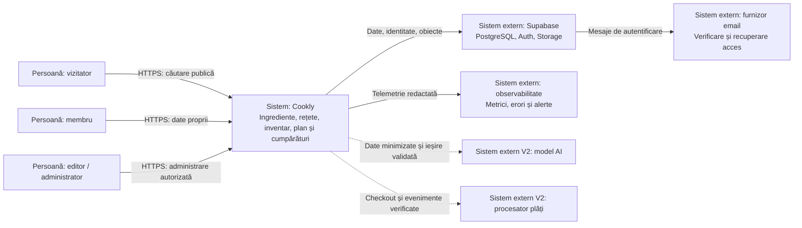
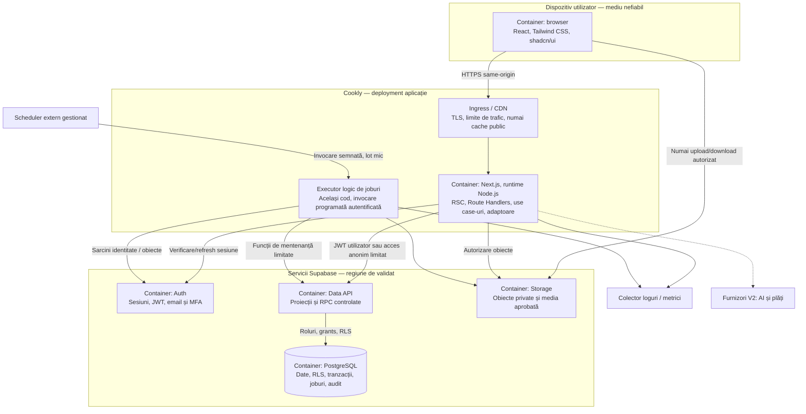
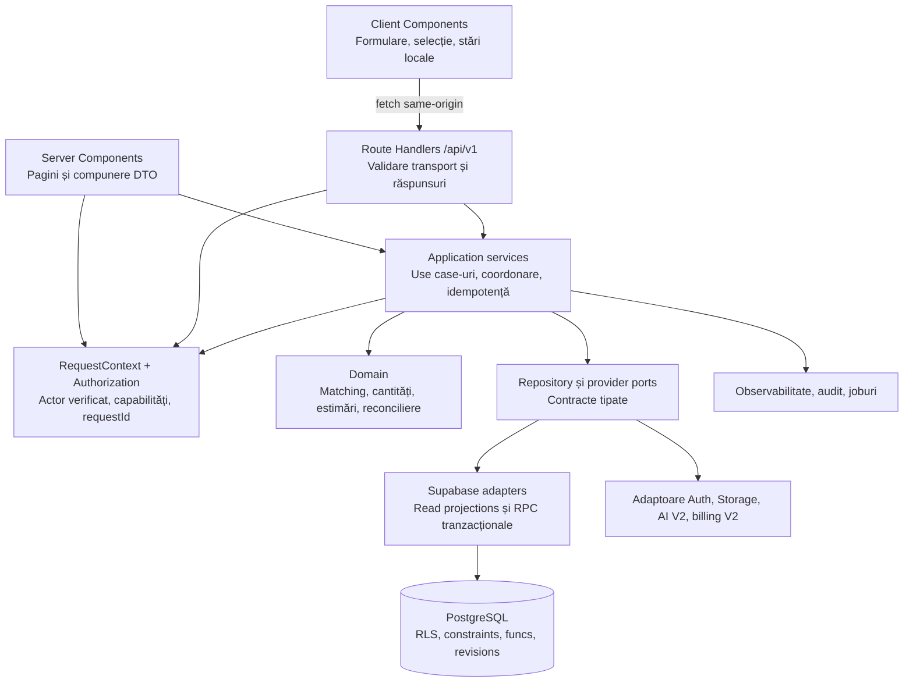
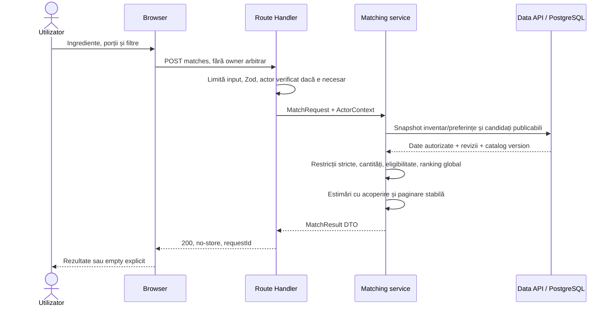
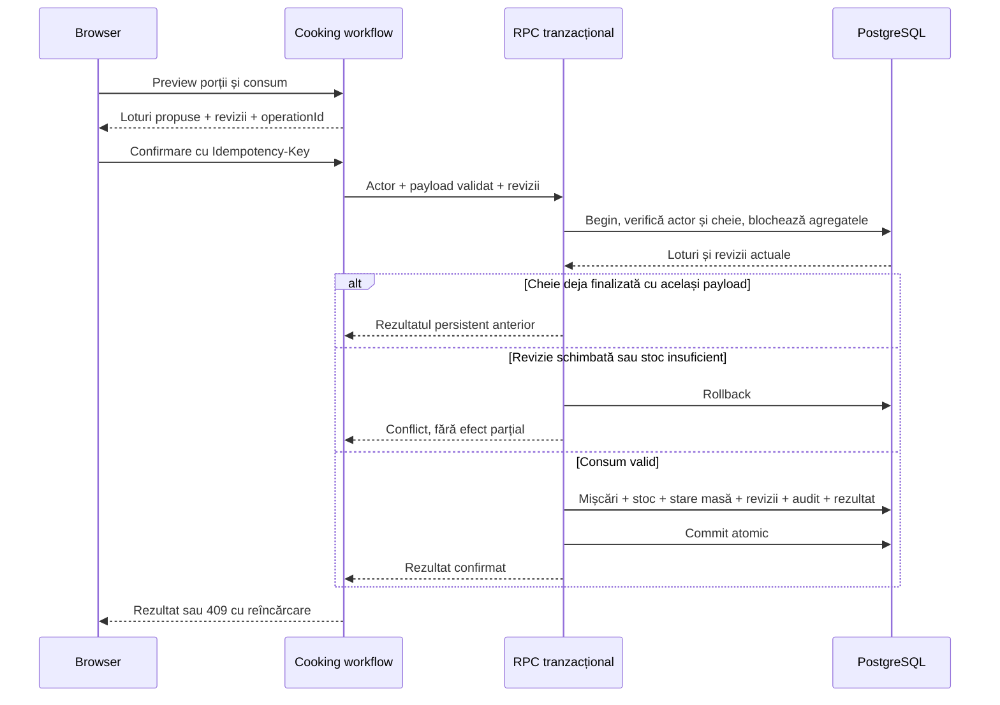
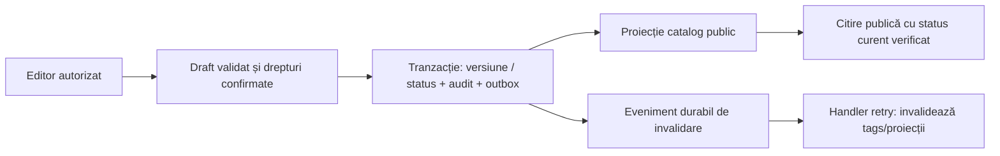
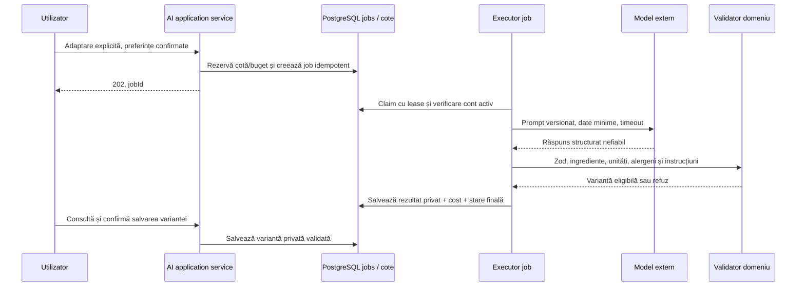

# Cookly — Arhitectura completă

Versiune: 1.0 · Data: 1 noiembrie 2026 · Etapa: 1 / 01 — Arhitectură și planificare  
Stare: proiectare pentru validare; fără implementare de funcționalități.

## 1. Bază, scop și limite

Documentul detaliază [PRD-ul Cookly](../product/PRD-Cookly.md), fără să îi schimbe scopul MVP/V2/V3. La inspecție, proiectul conține numai acel PRD; nu există cod, `package.json`, schemă, migrații sau teste. Structura propusă mai jos este convenția pentru implementarea viitoare, nu o structură deja creată.

Stack confirmat: Next.js App Router, React, TypeScript strict, Tailwind CSS, shadcn/ui, Zod, PostgreSQL și Supabase Auth/Storage. Alegerea arhitecturală este un **modular monolith**: un repository și o aplicație Next.js deployabilă, cu module de domeniu explicite, o bază PostgreSQL și servicii gestionate pentru identitate și fișiere. Nu există un backend HTTP separat pentru MVP.

MVP include catalog, ingrediente, matching, filtre, inventar, favorite, plan, cumpărături, estimări, conturi și admin. AI generativ, comunitatea și billing sunt proiectate ca extensii V2; nu vor fi scaffoldate sau expuse în MVP. Piața România/RON, furnizorul de hosting, regiunea, bugetul și țintele operaționale din PRD rămân de validat. Versiunile exacte ale bibliotecilor se fixează la inițializarea autorizată a proiectului; acest document nu prescrie un număr de versiune neverificat local.

Termenul „container” din diagrame este cel C4 — aplicație sau serviciu cu responsabilitate de execuție — și nu presupune Docker. Diagramele folosesc sintaxa Mermaid `flowchart` și `sequenceDiagram`, cu nivelurile C4 etichetate explicit pentru portabilitate.

## 2. Principii și decizii de bază

1. PostgreSQL este sursa de adevăr pentru date, integritate, autorizarea datelor și starea operațiunilor. UI și cache-ul nu confirmă singure o mutație.
2. Interfața cheamă use case-uri; nu interoghează direct tabelele aplicației. Validarea se repetă pe server, indiferent de validarea formularului.
3. Identitatea utilizatorului provine din token verificat. Proprietarul resursei nu este acceptat ca autoritate din payload.
4. Matchingul, conversiile și calculele sunt deterministe și testabile separat de React, rețea sau AI. Datele necunoscute rămân necunoscute.
5. Fiecare modul deține datele și mutațiile sale. Workflow-urile între module au coordonare explicită și tranzacții limitate, nu importuri circulare.
6. Cache partajat numai pentru proiecții publice sigure. Datele personale, cookie-urile de sesiune și răspunsurile AI private nu intră în cache public.
7. Nicio operațiune importantă nu depinde de continuarea execuției după terminarea unei cereri serverless. Exporturile, ștergerile și retry-urile au stare durabilă.
8. Integrarea nouă sau serviciul extern se adaugă numai după justificare prin cerință, măsurare sau cost operațional.

## 3. C4 — context



Sursele pentru rețete, nutriție și prețuri sunt importate și verificate editorial; nu sunt dependențe live ale căutării în MVP. Lipsa unui furnizor de prețuri nu trebuie să oprească accesul la rețete. Utilizatorul își poate folosi contul fără AI.

## 4. C4 — containere și granițe de încredere



Executorul de joburi este un rol logic al monolitului, nu un microserviciu MVP. Schedulerul face cereri scurte, autentificate, către un endpoint intern; fiecare invocare preia un lot cu lease și poate continua la următoarea invocare. Dacă hostingul nu poate executa în limitele necesare, același cod de job se mută într-un worker separat, fără mutarea regulilor de domeniu.

Browserul nu primește acces administrativ la PostgreSQL sau chei privilegiate. Data API rămâne o suprafață accesibilă din rețea: protecția sa trebuie să reziste și la apeluri directe care ocolesc Next.js.

## 5. Module, proprietatea datelor și dependențe

| Modul | Responsabilitate și date deținute | Contract intern principal | Dependențe permise |
|---|---|---|---|
| `identity` | Profil, preferințe, status cont, roluri protejate, cereri export/ștergere; Auth deține credențialele | `getActor`, `getPreferences`, `requireCapability`, `requestDeletion` | Adaptor Supabase Auth; porturi de export ale modulelor |
| `catalog` | Ingrediente canonice, aliasuri, unități/conversii editoriale, rețete și versiuni, clasificări, publicare, referințe media | `resolveIngredients`, `findCandidates`, `getPublishedRecipe`, `publishVersion` | Identitate pentru drepturi editoriale, port media |
| `matching` | Evaluare de disponibilitate, eligibilitate, filtre și ranking; fără tabele proprii în MVP | `searchMatches`, `evaluateRecipe` | Contracte de citire catalog, inventar, preferințe și estimări |
| `inventory` | Loturi, revizie inventar, mișcări, confirmări de gătire și compensări | `getSnapshot`, `previewConsumption`, `confirmCooking` | Catalog pentru identități/unități; port plan la coordonare |
| `favorites` | Favorite unice și private | `listFavorites`, `setFavorite` | Contract de vizibilitate catalog |
| `meal-planning` | Intrări pe dată locală/masă, versiune rețetă, porții, revizie plan | `getPlan`, `upsertMeal`, `removeMeal` | Catalog, preferințe |
| `shopping` | Lista activă, linii manuale/derivate, proveniență, revizie și reconciliere | `previewList`, `regenerateList`, `checkItem` | Snapshot plan, inventar și cantități catalog |
| `nutrition-pricing` | Referințe, surse, prețuri regionale, versiuni și rezultate calculate eligibile | `estimateRecipe`, `estimateMissing`, `getCoverage` | Catalog și aritmetică de cantități |
| `admin` | Ecrane și coordonare operațiuni privilegiate; nu dublează tabelele domeniilor | Use case-uri administrative autorizate | API-urile publice ale modulelor; audit |
| `ai`, V2 | Solicitări, cote, rezervări de buget, versiune prompt/model, variante private | `requestAdaptation`, `getJob`, `acceptVariant` | Catalog, matching și estimări prin contracte, adaptor model |
| `community`, V2 | Propuneri, comentarii, ratinguri, raportări și decizii de moderare | `submitRecipe`, `reportContent`, `moderate` | Identitate; port editorial catalog |
| `billing`, V2 | Evenimente procesator, abonamente și drepturi premium | `getEntitlements`, `createCheckout`, `applyProviderEvent` | Identitate minimală, adaptor procesator |

`shared` conține numai primitive: ID-uri, Quantity, Money, CalendarDate, DTO-uri comune de eroare și porturi de infrastructură. Nu devine un modul cu toate regulile produsului. Loggingul, auditul, joburile și rate limitingul sunt infrastructură transversală, cu acces prin porturi.

Reguli de import: `presentation → application → domain`; adaptoarele implementează porturile application. Domeniul nu importă Next.js, React sau Supabase. Modulele consumă doar exporturile explicite din `contracts`, nu repository-urile altora. Compoziția server injectează adaptoarele, evitând cicluri precum identity → toate modulele → identity.

Pentru operațiuni atomice între inventar și plan se acceptă o **excepție controlată**: un workflow tranzacțional DB, deținut în comun și revizuit de modulele participante. El folosește primitive SQL interne de mutație ale acestora, nu update-uri ad-hoc din alt modul. Nu se folosește un eveniment asincron pentru a garanta scăderea stocului.

## 6. C4 — componente în monolit



Săgeata port → adaptor reprezintă legarea la execuție; dependența de cod a adaptorului este spre interfața portului. Nici Route Handler, nici Server Component nu implementează ranking, conversii sau SQL.

## 7. Separarea frontend/backend și structura propusă

Paginile și layouturile folosesc Server Components pentru citire și randare inițială. Componentele client sunt insule pentru inputuri, autocomplete, porții, dialoguri, calendar și bifare. DTO-urile trimise clientului conțin doar câmpurile necesare; obiectele DB, tokenurile și metadatele interne nu se serializează implicit. Acest mod de compoziție urmează modelul [Server/Client Components din Next.js](https://nextjs.org/docs/app/getting-started/server-and-client-components).

RSC apelează direct serviciul application în proces, fără `fetch` către propriul `/api`. Client Components folosesc Route Handlers pentru interacțiuni după încărcare. Decizie propusă: mutațiile de domeniu au un singur transport HTTP explicit în MVP; nu se dublează aceleași mutații și prin Server Actions. Server Actions pot fi adoptate ulterior doar ca adaptoare către aceleași use case-uri, cu aceleași verificări.

```text
docs/
  product/PRD-Cookly.md
  architecture/ARCHITECTURE-Cookly.md
src/                         # propunere; nu este creat acum
  app/
    (public)/                # rețete, căutare, pagini publice
    (auth)/                  # intrare, verificare, recuperare
    (account)/               # inventar, favorite, plan, listă, profil
    admin/                   # rutare separată, aceleași verificări server
    api/v1/                  # adaptoare HTTP
    api/internal/jobs/       # invocare autenticată de scheduler
    auth/callback/
  modules/<module>/
    contracts/               # scheme Zod/DTO publice, fără dependențe server
    domain/                  # funcții și reguli independente
    application/             # use case-uri și porturi
    infrastructure/          # repository-uri și adaptoare server-only
    presentation/            # componentele modulului
  workflows/                 # compoziție explicită între module
  components/ui/             # primitive shadcn/ui și convenții a11y
  server/                    # composition root, context, config, observabilitate
  shared/                    # primitive stabile, puține
supabase/
  migrations/                # DDL, RLS, funcții, grants; viitoare
  tests/                     # integritate, roluri și concurență; viitoare
tests/e2e/                   # viitoare
```

Tailwind definește tokenuri vizuale și responsive; shadcn/ui oferă primitive controlate local. Accesibilitatea nu este presupusă doar din alegerea componentelor: focus, nume accesibile, dialoguri, anunțuri și navigarea cu tastatura se verifică în fluxurile compuse.

Starea locală React păstrează formulare și ingrediente temporare pentru vizitator. Nu se introduce Redux sau alt manager global fără nevoie demonstrată. Parametrii publici precum textul și pagina pot fi în URL; inventarul, excluderile sensibile și cantitățile personale nu se pun implicit în URL/loguri. Filtrele personale se trimit prin POST la matching. Importul inventarului de vizitator cere confirmare și nu suprascrie date existente.

## 8. API-uri și contracte de servicii

### 8.1 Convenții

API-urile de mai jos sunt contracte proiectate, nu endpointuri implementate. Prefixul `/api/v1` este pentru suprafața browserului și clienților ulteriori, nu o promisiune de API public comercial. ID-urile sunt opace; paginarea are cursor opac legat de filtre și ordonare stabilă. Limită implicită 20, maximă 50 elemente. Matching acceptă maximum 30 ingrediente canonice unice și 1–20 porții întregi, în acord cu PRD.

La fiecare intrare: limită de dimensiune → parsare și schemă Zod → identitate/capabilitate când este necesar → validare de domeniu → repository → DTO de ieșire. Cererile private nu pot furniza un `ownerId` arbitrar; valoarea este derivată din actorul verificat. Tipurile TypeScript se deduc din scheme unde este potrivit; răspunsurile externe și parametrii sunt validate la runtime.

DTO-uri conceptuale:

| Contract | Câmpuri și invariante |
|---|---|
| `Quantity` | Valoare zecimală ca șir, unitate canonică, dimensiune; necunoscutul este stare distinctă, nu `0` |
| `ActorContext` | ID verificat, status activ, capabilități evaluate server-side, nivel MFA unde este necesar, requestId; nu vine din JSON client |
| `MatchRequest` | Mod catalog/inventory/explicit, ingredient IDs și cantități opționale, porții, filtre, sortare, cursor; inventarul server se citește după actor |
| `MatchResult` | Recipe/version ID, disponibilitate pe ingredient, deficit, motiv de eligibilitate, procent de prezență, estimări cu acoperire, versiuni de intrare |
| `Estimate` | Stare complete/partial/unavailable, valori cunoscute, surse/date, referințe lipsă, monedă dacă este cost; niciodată total complet cu date lipsă |
| `CommandResult` | Resursă/revizie nouă și operationId; repetarea aceleiași operațiuni returnează același rezultat logic |
| `ApiError` | Cod stabil, mesaj sigur, fieldErrors după caz, requestId, retryable; fără SQL, stack sau tokenuri |

Mutațiile concurente trimit revizia așteptată (`expectedRevision`) în corp. Update-ul verifică revizia în aceeași operațiune DB; nepotrivirea produce 409. Operațiunile cu efect multiplu folosesc `Idempotency-Key`, legat de actor, tip operațiune și hash de payload. Refolosirea cheii cu alt payload produce 409, nu al doilea efect.

### 8.2 Suprafața MVP

| Metodă și rută | Actor | Serviciu / efect |
|---|---|---|
| `GET /ingredients?query=...` | Public | Rezolvă aliasuri și sugestii publice; limită de text și rată |
| `GET /recipes`, `GET /recipes/{id}` | Public | Proiecții publicate; detaliul verifică retragerea |
| `POST /matches` | Public sau membru | Matching explicit/pe inventar; fără efect de persistență și fără cache public |
| `GET /inventory`, `POST /inventory/lots` | Membru | Snapshot / creare lot |
| `PATCH /inventory/lots/{id}`, `DELETE /inventory/lots/{id}` | Proprietar | Actualizare/ștergere cu revizie și verificări de domeniu |
| `GET /favorites`, `PUT /favorites/{recipeId}`, `DELETE /favorites/{recipeId}` | Membru | Listare și stare favorită idempotentă |
| `GET /meal-plan?from=...&to=...`, `POST /meal-plan/entries` | Membru | Plan pe interval limitat / adăugare |
| `PATCH /meal-plan/entries/{id}`, `DELETE /meal-plan/entries/{id}` | Proprietar | Mutare, porții sau eliminare cu revizie |
| `POST /cooking/preview`, `POST /cooking/confirmations` | Membru | Consum propus / confirmare atomică, idempotentă |
| `POST /cooking/confirmations/{id}/compensations` | Proprietar | Corecție explicită; fără ștergerea istoricului |
| `GET /shopping-list`, `POST /shopping-list/preview`, `POST /shopping-list/regenerate` | Membru | Citire, diferențe, reconciliere atomică |
| `POST /shopping-list/items`, `PATCH /shopping-list/items/{id}`, `DELETE /shopping-list/items/{id}` | Proprietar | Linii manuale/bifări; liniile derivate au reguli distincte de editare |
| `GET /profile`, `PATCH /profile` | Membru | Preferințe și versiune; niciun rol privilegiat în schema editabilă |
| `POST /account/exports` | Membru reautentificat | 202 + job ID; urmărire prin cont activ |
| `POST /account/deletion` | Membru reautentificat | 202 + confirmare de acceptare și receiptId opac; blochează contul și încheie sesiunea, fără polling ulterior |
| `GET /account/jobs/{id}` | Proprietar cu cont activ | Starea exporturilor; exportul reușit oferă download privat cu expirare; nu expune jobul de ștergere |
| `POST /media/uploads`, `POST /media/uploads/{id}/finalization` | Editor autorizat în MVP | Intenție de upload și validare/atașare după verificare; fără publicare implicită |
| `POST /admin/recipes`, `PATCH /admin/recipes/{id}` | Editor autorizat | Draft/versiune nouă; validare editorială |
| `POST /admin/recipes/{id}/publication`, `POST /admin/recipes/{id}/withdrawal` | Editor autorizat | Publicare/retragere atomică și audit |
| `/admin/ingredients`, `/admin/references`, `/admin/users/{id}/status`, `/admin/roles` | Capabilități distincte | CRUD editorial sau comenzi privilegiate, fără rol universal implicit |

Toate rutele din tabel sunt relative la `/api/v1`. Auth folosește adaptoare către Supabase pentru sign-up, sign-in, sign-out, recuperare și callback PKCE, fără mecanism propriu de parole. URL-urile de redirect sunt allowlistate. Numele exacte se fixează cu schema OpenAPI la implementare; tabelele de mai sus definesc responsabilitățile obligatorii.

V2: `/ai/adaptations` și statusul solicitării; `/community/submissions`, comentarii/ratinguri/raportări; `/billing/checkout`, `/billing/portal` și webhook separat. Webhookul verifică semnătura pe corpul original și nu folosește sesiunea browserului. Endpointul `/api/internal/jobs/run` verifică semnătura schedulerului, expirarea și protecția anti-replay; nu acceptă un userId și o acțiune arbitrară de la internet.

## 9. Acces PostgreSQL, RLS și integritate

### 9.1 Strategie de acces aleasă

Propunere MVP: `@supabase/supabase-js` pentru Data API, `@supabase/ssr` pentru sesiunea Next.js și SQL versionat pentru migrații, proiecții și tranzacții. Necesitatea lor rezultă din integrarea Supabase; nu sunt instalate acum. Nu se introduce ORM sau conexiune PostgreSQL privilegiată pentru fiecare cerere.

Repository-urile server-side folosesc un client **per request**, cu cheia publicabilă și JWT-ul utilizatorului verificat; pentru citirile publice, un context anonim fără cookie-uri. Clientul autentificat nu se partajează între cereri. Tipurile DB sunt generate din schemă la build/CI și mapate la tipurile de domeniu, nu distribuite în UI.

Separarea propusă de scheme:

- `app_private`: tabele, proiecții interne și primitive de mutație; schema nu este expusă în Data API.
- `api`: numai proiecții de citire aprobate și funcții RPC; fără expunere accidentală a noilor tabele.
- `auth` și `storage`: gestionate de Supabase; aplicația nu modifică direct tabelele de credențiale sau catalogul intern al obiectelor.

Proiecțiile API de citire folosesc `security_invoker`, cu grants SELECT minime pe tabelele necesare și RLS activă. Aliasurile publice și rețetele publicate sunt citibile anonim; datele private cer `auth.uid()` și cont activ. Schema neexpusă nu înlocuiește RLS sau grants. Vizualizările pot necesita drepturi pe tabelele suport, fără a expune acele tabele ca endpointuri REST. Atenția la views și chei care ocolesc RLS este susținută de [documentația Supabase RLS](https://supabase.com/docs/guides/database/postgres/row-level-security).

### 9.2 Mutații care rezistă ocolirii backendului

Utilizatorii `anon`/`authenticated` nu primesc INSERT/UPDATE/DELETE direct asupra tabelelor aplicației. Mutațiile sunt RPC înguste. Deoarece o funcție `security invoker` ar avea aceleași lipsuri de drepturi, aici se folosește deliberat o excepție: funcții `security definer`, deținute de un rol dedicat `NOLOGIN`, fără `BYPASSRLS`, care nu este proprietarul tabelelor și nu este superuser.

Rolul executor primește numai drepturile necesare funcțiilor aprobate; RLS rămâne aplicabilă și verifică identitatea JWT din cerere, nu `current_user` ca identitate a persoanei. Se activează `FORCE ROW LEVEL SECURITY` pe tabelele aplicației ca protecție suplimentară. Politicile și grants pentru rolul executor sunt testate explicit. Fiecare funcție verifică actor activ, proprietar/capabilitate, limite, revizii și regulile critice, inclusiv dacă este apelată direct în Data API.

Verificările de status/capabilități folosesc un helper intern îngust, fără argument arbitrar de utilizator, care citește numai metadatele de securitate ale lui `auth.uid()`. Tabelele acestor metadate au politici de bază nerecursive; nu reapelează helperul de status din propria politică. Nu se pune o politică autoreferențială pe profil care să recitească același profil prin ea însăși. Modificarea statusului/rolurilor altui cont folosește o comandă privilegiată distinctă și auditată.

Pentru fiecare RPC: nume și argumente fixe, `search_path` gol sau fix sigur, obiecte calificate cu schemă, fără SQL din input; EXECUTE revocat implicit pentru PUBLIC și acordat numai rolurilor necesare. Primitivele interne nu sunt expuse și nu primesc EXECUTE de la clienți. Rolul executor nu poate modifica rolurile, politicile sau granturile. Funcțiile privilegiate de mentenanță au un rol/executor separat de funcțiile pentru membri. Distincția invoker/definer și restrângerea funcțiilor sunt descrise în [ghidul Supabase pentru funcții DB](https://supabase.com/docs/guides/database/functions).

Această alegere implică mai mult SQL de securitate, dar previne ocolirea regulilor de stoc printr-un apel direct. TypeScript validează UX și orchestrarea; DB revalidează invariantele autoritative. Acestea nu sunt două implementări independente de ranking: matchingul rămâne serviciu TypeScript, iar SQL protejează cantități, acces, versiuni și efecte atomice.

### 9.3 Model logic și constrângeri

| Grup | Entități / constrângeri importante |
|---|---|
| Identitate | Profil legat de identitatea Auth; roluri într-o tabelă protejată separată; cont activ verificat în politici și RPC |
| Catalog | Ingredient și alias unic normalizat; unități; rețetă + versiuni publicate imuabile; ingredient/pas legat de versiune; minimum un ingredient obligatoriu la publicare |
| Inventar | Lot cu proprietar și revizie; quantity/unit fie ambele cunoscute, fie stare necunoscută; cantitate cunoscută ≥0; mișcări și confirmationId unice |
| Plan | Intrare cu owner, dată locală, masă, versionId și 1–20 porții; revizie la nivel de plan și intrare |
| Cumpărături | Unicitate listă activă per owner; item manual/derivat; contribuții ale meselor; revizie și snapshot de generare |
| Favorite | Unicitate `(owner_id, recipe_id)` |
| Referințe | Ingredient, sursă, versiune, unitate, dată; preț cu regiune/monedă; completitudine explicită |
| Operațiuni | Cheie idempotență + actor + tip, hash payload, rezultat; audit append-only; joburi și outbox |

FK-urile pentru resurse private includ proprietarul când relația poate lega date între utilizatori: o linie de listă nu poate referi lista altui owner. Tabelele copil au politici proprii; RLS pe părinte nu protejează automat toate căile de citire ale copilului.

Cantități: `numeric(18,6)` pentru stoc și rețete, cu limite de domeniu mai mici la input; valoarea traversează JSON ca șir zecimal. Banii și prețurile folosesc numeric cu monedă explicită și rotunjire numai la prezentare. Implementarea va alege un adaptor decimal mic, justificat pentru evitarea erorilor IEEE-754; biblioteca exactă rămâne de validat, fără calcule monetare prin conversie implicită la `number`. Datele planului/expirării sunt `date`; momentele operațiunilor sunt `timestamptz`. Fusul profilului determină ce înseamnă „astăzi”.

Indexuri inițiale propuse: owner + dată/revizie pentru date private, ingredient ID pe relația cu rețete, versiuni publicate, alias normalizat, status + `next_run_at` pentru joburi, cheile unice de idempotență. Căutarea începe cu text normalizat și indexuri PostgreSQL; `pg_trgm`/FTS sunt opțiuni de extensie motivate prin benchmark de diacritice și relevanță, nu extensii presupuse instalate.

## 10. Tranzacții și fluxuri de date

### 10.1 Matching: citire, eligibilitate și ranking



Nu se paginează arbitrar candidații înainte de scoring, ceea ce ar pierde rețete mai bune. MVP evaluează toate candidatele eligibile în limita catalogului țintă, cu date batch și coloane minimale; nu face N+1 interogări per rețetă. Un read-RPC dedicat produce snapshotul autorizat și setul compact de candidați într-o singură instrucțiune de citire consistentă, fără trunchiere la limita implicită de rânduri Data API. Dimensiunea/timeoutul RPC sunt măsurate pe profilul țintă; depășirea limitei produce eroare explicită, nu rezultate incomplete prezentate ca exhaustive. Cursorul include fingerprintul cererii, reviziile relevante și cheia de sortare. Dacă inventarul/preferințele/catalogul s-au schimbat, se cere repornirea paginării; nu se amestecă snapshoturi incompatibile.

Pentru inventar persistent, snapshotul include cantități eligibile, excluderea loturilor cu dată trecută, revizia inventarului și a preferințelor. Catalogul întoarce versiuni imuabile plus statusul curent de vizibilitate. Cantitatea necunoscută nu confirmă fezabilitatea. Rețetele fără un ingredient obligatoriu comun sunt excluse în modul inventar, conform PRD. Clasificarea: fezabil → necesită verificare → necesită cumpărături; se păstrează tie-breakerele PRD.

La scalare, rankingul se poate muta într-o interogare SQL/proiecție specializată numai cu teste de paritate. Un top-K aproximativ poate fi introdus doar după acceptarea explicită a schimbării de relevanță; nu se adaugă o limită ascunsă pentru a atinge latența.

### 10.2 Confirmarea gătitului: exact un efect logic



În acest flux, 409 indică faptul că preview-ul nu mai poate fi aplicat stării curente, inclusiv dacă stocul s-a redus între preview și confirmare. O cerere care încalcă o regulă fără schimbare de snapshot, de exemplu o cantitate de consum nepermisă introdusă manual, primește 422. Repetarea unei chei finalizate cu același payload returnează rezultatul anterior înainte de verificarea reviziilor vechi din acel payload.

O singură RPC reprezintă tranzacția; mai multe apeluri Data API succesive nu formează o tranzacție. Se blochează întâi rândul agregatului de inventar per owner, apoi planul dacă este implicat, lista dacă este necesară și loturile în ordine de ID; toate workflow-urile respectă aceeași ordine. Toate mutațiile de inventar iau lockul agregatului, inclusiv crearea unui lot, pentru a evita schimbări neobservate ale snapshotului. Lockurile pe rânduri sunt un mecanism PostgreSQL documentat, folosit aici ca decizie Cookly pentru concurență. [PostgreSQL — Explicit Locking](https://www.postgresql.org/docs/current/explicit-locking.html)

O comandă confirmată este reținută ca resursă de domeniu și nu se uită după expirarea unei cache de idempotență. Pentru masa planificată există și unicitate pe confirmarea activă, prevenind dublarea cu chei diferite; gătirile repetate intenționate cer o operațiune nouă explicită. Compensarea este mișcare inversă validată, nu rescrierea istoricului. Deadlockurile/tranzacțiile reluabile au retry limitat numai cu aceeași cheie; 409 de business cere intervenție utilizator.

### 10.3 Regenerarea listei

1. Citire consistentă a meselor selectate și a reviziilor plan/inventar/listă; referințele la versiuni rețetă fixează cantitățile.
2. Agregare pe ingredient și dimensiune compatibilă, scalare porții, alocare o singură dată a stocului cunoscut; necunoscutele devin „Verifică acasă”.
3. Preview cu diferențe și origine per masă. Nu se rezervă sau consumă stoc.
4. La confirmare, RPC blochează agregatele în ordinea comună, recitește/verifică reviziile și revalidează necesarul din datele autoritative. Nu acceptă totalurile clientului drept adevăr.
5. Persistă reconcilierea și revizia în aceeași tranzacție; linii manuale neafectate, intrări derivate fără duplicate. O creștere de cantitate păstrează marcajul de cumpărat doar pentru partea deja confirmată și arată diferența rămasă; o bifare nu dovedește cumpărarea unei cantități suplimentare.

Calculul comun de agregare are exemple contractuale între TypeScript și RPC. La conflict se reface preview; confirmarea nu aplică un plan calculat pe un inventar expirat. Gătirea sau schimbarea planului marchează lista ca necesitând recalculare, fără a o modifica în fundal în timpul cumpărăturilor. Bifarea nu creează lot: adăugarea produselor cumpărate în inventar este o comandă separată confirmată.

### 10.4 Publicare, retragere și cache



Versiunile publicate nu se editează în loc. Favoritele referă rețeta logică; planul referă versiunea. Retragerea pentru siguranță blochează instrucțiunile și pentru planurile vechi; statusul curent nu este derivat doar din cache. Paginile sensibile la retragere nu se livrează ca HTML complet din CDN fără verificare server. Conținutul deja descărcat de utilizator nu poate fi retras de pe dispozitiv.

## 11. Autentificare, autorizare și sesiuni

Flux propus: email/parolă → verificare email → sesiune Supabase → cookie-uri gestionate de adaptorul SSR → context server verificat → RLS/RPC cu identitatea persoanei. Recuperarea accesului folosește token unic și redirect permis; schimbarea parolei nu este gestionată de cod propriu.

Integrarea SSR folosește clienți separați browser/server și refresh în mecanismul de request potrivit versiunii Next.js alese (`proxy` în ghidul consultat). Identitatea se verifică prin metoda SDK recomandată pentru tokenuri, nu prin încredere în `getSession()` sau în simpla prezență a cookie-ului. Pentru starea actuală a utilizatorului/reautentificare se verifică și Auth când este necesar. Aceste distincții sunt documentate în [Supabase SSR](https://supabase.com/docs/guides/auth/server-side/creating-a-client?framework=nextjs).

Nu se presupune că verificarea criptografică a unui JWT confirmă instantaneu revocarea sau rolurile actuale. Cookly verifică `account_status` și capabilitățile în date protejate, inclusiv în politicile DB. Dezactivarea/ștergerea blochează operațiile pe date imediat după commit; revocarea sesiunilor Auth se execută separat și se reîncearcă durabil. Rolurile nu se citesc din metadate editabile de membru. Admin și schimbarea rolurilor cer MFA și verificare proaspătă de capabilități; editorul nu primește acces la inventarele membrilor.

Cookie-urile au `Secure` în producție, SameSite conform fluxului și domeniu/path minim. Compatibilitatea cu adaptorul Supabase trebuie verificată înainte de a impune `HttpOnly` tuturor tokenurilor: SDK-ul browser poate necesita acces, deci nu se promite protecție HttpOnly inexistentă. Riscul XSS este tratat prin evitare HTML arbitrar, sanitizare unde se acceptă rich text, CSP, limitarea scripturilor terțe și redacția telemetriei.

Toate mutațiile browser verifică Origin/Host și token anti-CSRF de sesiune; CORS nu permite origini arbitrare cu credențiale. GET nu produce efecte. Ruta de callback validează state/PKCE prin SDK și nu acceptă open redirect. Răspunsurile cu `Set-Cookie`, date personale sau refresh nu se cache-uiesc în CDN. Recomandarea de a revalida accesul în fiecare intrare server și de a limita DTO-urile este aliniată cu [Next.js — Data Security](https://nextjs.org/docs/app/guides/data-security).

## 12. Storage și media

MVP folosește un bucket privat pentru originale editoriale și exporturi în bucket separat, cu politici distincte. Imaginile publicabile sunt derivate aprobate; pentru MVP se servesc din bucket privat prin acces temporar autorizat, astfel încât retragerea să poată opri emiterea de URL-uri noi. TTL propus al URL-urilor media: 5 minute; obiectele exportate: URL de 60 secunde după autorizare, fișier cu retenție propusă de 24 ore. Valorile se validează operațional.

Un URL deja semnat rămâne capabilitate de acces până expiră sau obiectul este eliminat; retragerea nu garantează ștergerea copiilor CDN/browser. Din acest motiv, exporturile au `private, no-store`, fără optimizator public de imagini. Dacă V3 folosește bucket public pentru media, acel conținut trebuie clasificat ca public și acceptat explicit ca nerevocabil imediat.

Flux upload: membru autorizat/editor → cere intenție de upload → cale generată server (`owner/id-random`, fără încredere în numele clientului) → upload în zonă privată → verificare bytes/MIME, dimensiune și rezoluție → eliminare EXIF și re-encodare → legare la resursă numai după verificare. Propunere MVP: JPEG/PNG/WebP, maximum 5 MB; fără SVG/HTML arbitrar. Originalele nevalidate nu devin accesibile public. Importurile de URL externe sunt excluse din MVP pentru a evita un fetcher SSRF implicit.

Metadatele, drepturile, textul alternativ și statusul sunt în DB. Fișierul și tranzacția DB nu sunt atomice: uploadul are stare pending/verified/attached/rejected, iar un job șterge orfanii și reîncearcă eliminările. Se folosește API-ul Storage, nu DELETE SQL asupra metadatelor interne. Controlul operațiunilor pe obiecte este fundamentat pe [politicile Storage/RLS Supabase](https://supabase.com/docs/guides/storage/security/access-control).

URL-urile semnate se emit la răspuns după gate-ul de vizibilitate, nu se stochează în proiecția de rețetă cache-uită. Un optimizator de imagini partajat nu trebuie să transforme media privată într-un răspuns public de lungă durată; în MVP se folosește servirea semnată directă, cu politica de cache verificată. Retragerea și expirarea se testează pe bytes, nu numai pe înregistrarea DB.

## 13. Caching și consistență

Nu se depinde de defaulturi Next.js care pot varia cu versiunea. La implementare se fixează modelul de caching, se documentează opțiunile folosite și se verifică răspunsurile efective cu două sesiuni. Documentația oficială distinge modelele și invalidarea; API-urile concrete se aleg după versiunea fixată. [Next.js — Caching](https://nextjs.org/docs/app/getting-started/caching)

| Date | Politică propusă | Cheie / invalidare |
|---|---|---|
| Asseturi aplicație | CDN, versionare prin hash | Build hash |
| Conținut rețetă publicată imuabilă | Cache server opt-in, TTL de siguranță 5 minute | RecipeVersion + locale + projectionVersion; status verificat separat, necached |
| Sugestii ingrediente publice | Cache server, TTL 5 minute | Query normalizat + locale + taxonomyVersion |
| Rezultate catalog public | MVP fără cache comun al paginii complete | Permit optimizare ulterioară numai cu status de publicare corect |
| Nutriție/preț pentru versiune rețetă | Calcul public cache-uit, fără stoc/preferințe | RecipeVersion + portions + referenceVersion + region/currency |
| Inventar, plan, listă, profil, favorite | Dinamic, `private, no-store`; memoizare doar în aceeași cerere dacă sigură | Revizii pentru consistență, nu cache partajat |
| Matching personal și cost lipsuri | POST no-store, fără persistență implicită în cache comun | Request fingerprint doar pentru cursor, fără expunere date brute |
| Admin, auth, export și AI privat | No-store | Nicio cheie în cache public |

Un cache pentru catalog este construit dintr-un context explicit public fără cookie-uri. Nu se cache-uiește funcția care capturează un client Supabase autentificat. După commit, răspunsul mutației oferă revizia nouă; UI reîncarcă datele sau reconciliază DTO-ul confirmat. Evenimentele outbox reîncearcă invalidarea; TTL limitează vechimea în caz de eșec. Schimbarea preferințelor golește rezultatele personale din starea UI și declanșează reevaluarea compatibilității planului.

## 14. AI — integrare V2 fără afectarea MVP



Portul `AiProvider` ascunde SDK-ul furnizorului. Matchingul nu depinde de el. Jobul transmite versiunea de rețetă, porțiile, restricțiile necesare și instrucțiunea explicită, fără email, nume sau inventar complet implicit. Textul utilizatorului/rețetei este delimitat ca date; nu poate atribui modelului drepturi de acces sau tool-uri arbitrare.

Modelul nu primește SQL, secrete sau capacitatea de a publica, plăti ori modifica stoc. Ieșirea este candidat: schemă strictă → rezolvare ingrediente → cantități/unități → excluderi/allergeni → recalculare nutriție și cost din surse. Ingredientul nerecunoscut și evaluarea incompletă a alergenilor împiedică prezentarea ca variantă compatibilă. Textul procedural necesită reguli și evaluări suplimentare; validitatea Zod nu dovedește siguranța instrucțiunilor.

Se păstrează versiunea promptului, modelul declarat, token usage/cost, verdict și motiv, cu retenție minimă; prompturile brute nu se loghează implicit. Cota și bugetul se rezervă atomic înainte de apel și se reconciliază după. Timeoutul poate însemna cost la furnizor fără rezultat local; retry-ul este limitat, folosește idempotența furnizorului dacă există și nu promite „exactly once” pe serviciul extern.

Circuit breaker logic oprește apelurile când erorile/costul depășesc plafonul; fallbackul este rețeta editorială. Lansarea V2 cere evaluări adversariale, excluderi, doze/unități, conținut malițios, cost și confidențialitate, plus alegerea furnizorului și condițiilor de date. Streamingul poate arăta progres, dar nu afișează instrucțiuni neverificate ca rezultat final.

## 15. Comunitate și monetizare — extensii V2

Comunitatea deține propunerea; catalogul deține rețeta publicată. O aprobare de moderare transmite o comandă către catalog cu provenance, drepturi și versiune. Editarea unei rețete publicate produce o propunere nouă, fără a rescrie planurile existente. Comentariile/ratingurile sunt separate de instrucțiunile rețetei. Identitatea reală și datele private nu sunt incluse în profilul public. Raportările au audit și contestație; limitarea frecvenței și protecția anti-abuz sunt necesare înainte de lansare.

Billing verifică evenimentele semnate, persistă un `provider_event_id` unic și reconciliază abonamentul cu starea autoritativă a procesatorului când evenimentele ajung în ordine inversă. Redirectul browserului după checkout nu acordă premium. Serviciul `getEntitlements` furnizează drepturi; celelalte module nu citesc direct tabelele procesatorului. Verificarea drepturilor se face server-side. În caz de indisponibilitate a plăților, funcțiile gratuite și accesul la datele proprii continuă.

Politicile privind conținutul după ștergerea contului, facturi/retentie și rambursări trebuie validate înainte de activarea modulelor. Nu se instalează preventiv SDK-uri AI sau plăți în MVP.

## 16. Joburi, evenimente, export și ștergere

Tabelul joburilor conține tip fix, owner dacă există, payload minimal, status pending/running/succeeded/failed, `next_run_at`, attempts, leaseUntil și ultimul cod de eroare sigur. Claim-ul atomic folosește lockuri pentru a preveni execuția concurentă a aceluiași job; lease-ul expirat permite recuperare. Retry cu backoff/jitter și număr maxim; eșecurile finale intră într-o coadă de intervenție, nu dispar.

Outboxul se scrie în aceeași tranzacție cu schimbarea de domeniu pentru invalidare, notificări și audit operațional extern. Livrarea este **at least once**; consumatorii deduplică după eventId. Nu se introduce Kafka sau broker separat în MVP. Rate limitingul durabil poate folosi contoare atomice PostgreSQL cu TTL și limite la ingress; memoria unei singure instanțe nu este limitator global. Cotele critice sunt verificate și în RPC pentru a rezista apelurilor directe; proiecțiile de citire sunt limitate ca volum și timp de execuție, iar protecțiile gatewayului Supabase se verifică separat de cele Next.js.

Exportul citește numai datele ownerului din porturi dedicate, include versiunea schemei și înregistrează cutoff-ul. Pentru MVP se propune snapshot logic prin agregarea datelor în DB la un moment definit, apoi serializare în job; dacă datele cresc peste limite, se folosește snapshot consistent prin conexiune dedicată, fără a pretinde consistență din pagini REST independente. Fișierul este privat și șters conform retenției aprobate.

Ștergerea este o saga durabilă, fiindcă Auth, Storage și DB nu au tranzacție comună: (1) reautentificare și cerere idempotentă; (2) blocare cont în DB; (3) revocare sesiuni; (4) eliminare/anonimizare date pe module și fișiere; (5) eliminare identitate Auth; (6) confirmare și dovadă operațională minimă. Pașii pot fi reluați; eșecul la Storage nu reactivează contul. Backups au retenție distinctă; la restaurare se reaplică registrul minim al ștergerilor pentru a nu reactiva date eliminate. Politica registrului se validează pentru minimizare și obligații aplicabile.

Răspunsul inițial de ștergere confirmă numai acceptarea, nu finalizarea eliminării: afișează termenul operațional aprobat și un receiptId opac pentru suport, apoi golește datele locale ale contului și sesiunea. ReceiptId nu este token de autentificare și nu permite interogarea datelor. Jobul continuă intern fără polling din contul dezactivat. Starea finală se păstrează în dovada operațională cu retenție minimă; nu se adaugă implicit o notificare email care ar necesita păstrarea adresei după ștergere. Exporturile sunt un flux diferit și pot fi urmărite cât timp contul este activ.

Cheia administrativă Supabase necesară operațiunilor Auth este disponibilă numai executorului de mentenanță dacă platforma permite separarea secretelor pe funcție. Dacă hostingul oferă doar secrete la nivel de deployment, monolitul nu asigură izolare fizică a secretelor: adaptorul este `server-only`, accesul este îngust și auditat, iar separarea într-un worker devine prioritară când riscul justifică. Traficul obișnuit nu folosește niciodată cheia privilegiată pentru a ocoli politicile.

## 17. Logging, erori și stări de interfață

### 17.1 Model de eroare

| Cod | HTTP | Comportament |
|---|---|---|
| `VALIDATION_ERROR` | 400 | Mesaje pe câmp, fără pierderea formularului |
| `UNAUTHENTICATED` | 401 | Reautentificare; datele private nu rămân vizibile altui cont |
| `FORBIDDEN` | 403 | Capabilitate insuficientă; pentru resursa privată a altcuiva se poate răspunde 404 pentru a nu divulga existența |
| `NOT_FOUND` / `RECIPE_UNAVAILABLE` | 404 sau 410 | Inexistent/retras conform contextului public permis |
| `REVISION_CONFLICT` / `IDEMPOTENCY_CONFLICT` | 409 | Reîncărcare/preview nou; fără retry orb al payloadului vechi |
| `DOMAIN_RULE_VIOLATION` | 422 | Explică stoc insuficient, unitate incompatibilă sau altă regulă corectabilă |
| `RATE_LIMITED` | 429 | Retry-After și păstrarea intrării |
| `DEPENDENCY_UNAVAILABLE` | 503 | Fallback, retry limitat și requestId |
| `INTERNAL_ERROR` | 500 | Mesaj sigur; detaliul redactat numai în logul server |

Lipsa rezultatelor este 200 cu listă goală. Datele nutriționale parțiale sunt răspuns valid cu acoperire, nu eroare 500. Erorile așteptate se întorc tipat; excepțiile neașteptate ajung în error boundary și logger. Clientul ignoră răspunsurile de căutare depășite folosind anulare/identificator de cerere, astfel încât o căutare veche să nu suprascrie noua selecție.

### 17.2 Observabilitate

Loguri JSON: timp UTC, nivel, requestId/traceId, modul, operațiune, durată, cod rezultat și dependență; fără parole, JWT, cookie-uri, URL-uri semnate, inventar brut sau prompturi. User ID se include numai dacă este necesar operațional și permis, separat de analitice. Logurile de audit sunt append-only pentru rolurile aplicației, cu acces și retenție separate de debug.

Metrici: latențe p50/p95/p99, rate erori, interogări lente, conflicte, backlog și vechime joburi, invalideri eșuate, export/ștergere, eșecuri auth și acces refuzat; V2 cost AI și reconciliere billing. Trace-ul leagă Route Handler → use case → Data API; cheile nu sunt propagate. Alertele urmăresc SLO-ul și simptomele utilizatorilor, nu doar CPU. Analiticele de produs respectă definițiile și minimizarea din PRD și sunt distincte de logurile operaționale.

### 17.3 UI și accesibilitate

`loading.tsx`/Suspense pentru segmentele potrivite, feedback local pentru mutații și `error.tsx` pentru erori neașteptate; empty și erorile de business sunt componente explicite. Confirmările de stoc/listă așteaptă serverul; favoritele pot fi optimiste cu rollback. Butonul ocupat previne clickuri repetate vizual, iar idempotența protejează și apelurile duplicate reale.

Autocomplete are navigare cu tastatura și anunțuri, calendarul oferă și selectare fără drag, dialogul păstrează/restaurează focusul, erorile sunt asociate câmpurilor. Rezultatul nu se exprimă numai prin culoare. La sesiune expirată, formularul nesensibil poate fi păstrat local, dar datele contului anterior se elimină din UI la logout/schimbare cont. Ținta WCAG și verificările manuale rămân cele din PRD.

## 18. Securitate, deployment și operare

| Amenințare / problemă | Control proiectat |
|---|---|
| IDOR și acces între conturi | Actor verificat, RLS pe fiecare tabel, FK owner-aware, teste prin BFF și apel direct Data API |
| Ocolirea serviciului prin SDK direct | Tabele fără DML pentru utilizatori; RPC cu reguli critice și capabilități, EXECUTE minim |
| XSS / conținut nefiabil | Fără HTML arbitrar în MVP, sanitizare editorială, CSP, verificări upload, minimizare scripturi |
| CSRF și redirect abuziv | Same-origin, token CSRF, metode corecte, allowlist redirect, PKCE/state |
| Secret expus | Config validată server, `server-only`, separare chei publicabile/privilegiate, scanare secrete și redacție |
| Abuz/cost excesiv | Limite input/rate, timeout, cote tranzacționale, buget și alerte |
| Funcție SQL cu privilegii excesive | Rol NOLOGIN fără bypass, grants minime, search_path sigur, review și teste de apel direct |
| Retragere mascată de cache | Gate de status necached, invalidare durabilă și TTL, pagini fără CDN public complet |

Medii separate: local, staging/preview și producție, cu proiecte/credențiale Supabase distincte și date sintetice în non-producție. Preview-urile nu au secrete sau copii de date personale din producție. Hostingul Node.js este plasat aproape de regiunea DB; nu se alege Edge Runtime pentru use case-urile principale fără verificarea compatibilității și latenței.

CI viitor: verificări de formatare/lint, TypeScript strict, teste de domeniu, DB/RLS, contracte, E2E esențiale și build. Migrațiile au o singură sursă SQL versionată, aplicate controlat, nu schimbări manuale neînregistrate în dashboard. Strategia expand → backfill → compatibilitate → contract permite rollbackul aplicației fără rollback distructiv imediat al datelor. Datele editoriale importate păstrează sursa și versiunea; seedurile de test nu conțin date reale.

Backupul DB, obiectele Storage și configurația Auth au plan de recuperare separat; backupul PostgreSQL nu este presupus copie a bytes-urilor Storage. Țintele PRD RPO ≤24 h, RTO ≤8 h și disponibilitate 99,5% sunt condiționate de planul achiziționat și de exercițiu de restaurare real. Readiness verifică dependențele necesare fără a expune detalii publice; liveness nu provoacă reporniri doar pentru o dependență externă temporar căzută.

## 19. Decizii, compromisuri și riscuri

| ID | Decizie propusă | Beneficiu | Cost / risc / alternativă |
|---|---|---|---|
| A-01 | Modular monolith cu Next.js BFF | Tranzacții locale, deployment și dezvoltare mai simple | Izolare limitată; necesită reguli de import și ownership ferme |
| A-02 | RSC pentru citire, Route Handlers pentru interacțiuni | Mai puțin JS, transport explicit și reutilizarea use case-urilor | Mai multe DTO-uri; Server Actions pot reduce boilerplate ulterior |
| A-03 | Data API + SQL RPC, fără ORM inițial | JWT/RLS natural, tranzacții deliberate | SQL/security review mai mult; acces SQL direct este alternativă numai cu propagare sigură a identității |
| A-04 | DML blocat clienților, definer cu rol limitat | Invariantele rezistă ocolirii BFF | Complexitate de grants/RLS; eroarea de configurare este risc critic |
| A-05 | Matching determinist batch, catalog PostgreSQL | Explicabilitate și fără furnizor AI în calea critică | Scoring global poate costa; trebuie benchmark înainte de optimizare |
| A-06 | Fără rezervare de stoc | Mai puține blocaje și concepte în MVP | Planurile pot concura pe aceleași alimente; recalculare și revizii vizibile |
| A-07 | Cache conservator și gate pentru retrageri | Date private separate și status corect | Mai multe citiri DB și mai puțină paginare statică |
| A-08 | Joburi/outbox PostgreSQL | Durabilitate fără broker nou | Polling și curățare; worker/coadă dedicate dacă încărcarea o cere |
| A-09 | Media privată semnată în MVP | Revocarea emiterii URL-urilor noi | Mai multe operații și CDN mai limitat; URL existent valid până la expirare |
| A-10 | AI, comunitate și billing izolate conceptual în V2 | MVP rămâne centrat pe utilitate | Nu validează încă monetizarea sau costul moderării |
| A-11 | Decimal și versiuni imuabile | Calcule și planuri reproductibile | Mai multe mapări și retenție de versiuni |

Riscurile externe dominante rămân calitatea/licența catalogului, sursele nutriționale și de preț, capacitatea de moderare, bugetul și politicile privind datele. Arhitectura nu poate transforma date incomplete în recomandări sigure. Alegerile privind piața și retenția necesită validare de produs și specialiști relevanți, fără a presupune conformitate doar din alegerea Supabase.

## 20. Traseu de scalare bazat pe măsurare

1. **MVP:** un deployment Next.js scalabil orizontal, fără stare de sesiune în memorie; o instanță PostgreSQL gestionată, media Storage, joburi SQL și catalog țintă din PRD. Demonstrarea profilului de 10.000 rețete / 50 cereri pe secundă este un test viitor, nu capacitate măsurată.
2. **Optimizare înainte de distribuire:** EXPLAIN și metrici pe interogări, indexuri RLS/owner, batch, reducere DTO-uri, precomputarea caracteristicilor rețetelor și estimărilor publice; ranking SQL numai cu paritate. Dacă p95 de căutare depășește 800 ms în profilul PRD, se investighează fiecare segment înainte de a adăuga servicii.
3. **Separarea sarcinilor lente:** dacă backlogul sau runtime-ul joburilor depășesc limitele/SLO, executor separat cu aceeași versiune de module și secret administrativ izolat. Notificările și AI sunt primele candidate; consumul de stoc rămâne tranzacțional în DB.
4. **Capacitate suplimentară:** dimensionare PostgreSQL și conexiuni după utilizare; cache distribuit sau motor de căutare numai după demonstrarea blocajului. Proiecțiile externe au outbox, versiune și mecanism de rebuild; restricțiile și vizibilitatea se reverifică autoritativ.
5. **Gospodării V2:** nou principal de proprietate/membership și politici explicite, migrare controlată a datelor personale; nu se înlocuiește `owner_id` cu un ID de grup fără revizuirea întregii izolări.
6. **Extracție de servicii:** AI/media/billing se pot extrage când au SLO, echipă sau profil de scalare diferit. Contractele și outboxul există înaintea extracției. Inventarul, gătirea și lista nu se despart prematur, pentru a păstra atomicitatea. Nu se introduce tranzacție distribuită în MVP.

Replica de citire, dacă apare, deservește numai fluxuri care tolerează lag. Autorizarea, statusul de retragere și confirmările de stoc nu se bazează pe o replică întârziată. Scalarea frontendului nu elimină limitele bazei de date sau ale providerilor.

## 21. Verificare viitoare și trasabilitate la PRD

| Arie | Verificare necesară înainte de funcționalitate completă | Referință PRD |
|---|---|---|
| Matching/conversii | Cazuri deterministe, date necunoscute, unități incompatibile, prag comun, ranking global/paginare | US-01–04, FR-01–02 |
| Inventar și gătire | Tranzacții reale, apeluri concurente, chei repetate/diferite, rollback, compensare | US-05/09, FR-03 |
| Plan/listă/favorite | Agregare fără dublu stoc, regenerare, creștere cantitate bifată, schimbări simultane, rețetă retrasă | US-06–08, FR-04–05 |
| Cost/nutriție | Calcule decimal, porții, acoperire parțială, proveniență și surse schimbate | US-10, FR-06–07 |
| Auth/RLS/admin | Doi membri, vizitator/editor/admin, token expirat, status blocat, apel direct Data API, views/RPC/Storage | US-11–12, FR-08/11 |
| Cache/confidențialitate | Două sesiuni, logout/login alt cont, refresh cu Set-Cookie, retragere și eșec invalidare | NFR-01–04 |
| Joburi/export/ștergere | Lease expirat, retry, livrare duplicată, Storage/Auth căzut, restaurare cu ștergeri reaplicate | US-11, NFR-08–10 |
| UI/accesibilitate | Loading/empty/error, tastatură, cititor de ecran, mobil și performanță reală | §9, NFR-05/11 |
| AI/comunitate/billing V2 | Evaluări model, moderare și contestații, webhook duplicat/inversat și costuri | US-13–15, FR-09/10/12 |

Nu se adaugă teste de aplicație la această etapă: nu există runtime sau funcționalități. Verificarea livrabilului este documentară — coerență cu PRD, acoperirea modulelor, contracte și diagrame — și trebuie separată de executarea viitoare a testelor din tabel.

## 22. Decizii rămase și verificare manuală

Înainte de implementare se validează: A-01–A-11, inclusiv complexitatea RPC cu rol limitat; versiunile exacte Next.js/Supabase și modelul de caching; hosting/regiune și izolarea secretelor joburilor; sursele/licențele și precizia calculelor; piața/moneda; volumele și bugetul; limitele/retenția/exportul și ștergerea; observabilitatea și procesul de operare. Se păstrează și lista D-01–D-17 din PRD; această cerere de arhitectură nu constituie aprobarea implicită a ipotezelor comerciale.

De verificat manual acum: redarea celor trei niveluri C4 și a celor patru diagrame de flux, lizibilitatea granițelor de încredere, înțelegerea regulilor de stoc/cantități necunoscute și acceptarea compromisurilor A-01–A-11. Diagramele descriu sistemul proiectat, nu infrastructură existentă.

Nu au fost create funcționalități, migrații, configurații de producție, chei sau dependențe. Următoarea etapă necesită o cerere separată.
