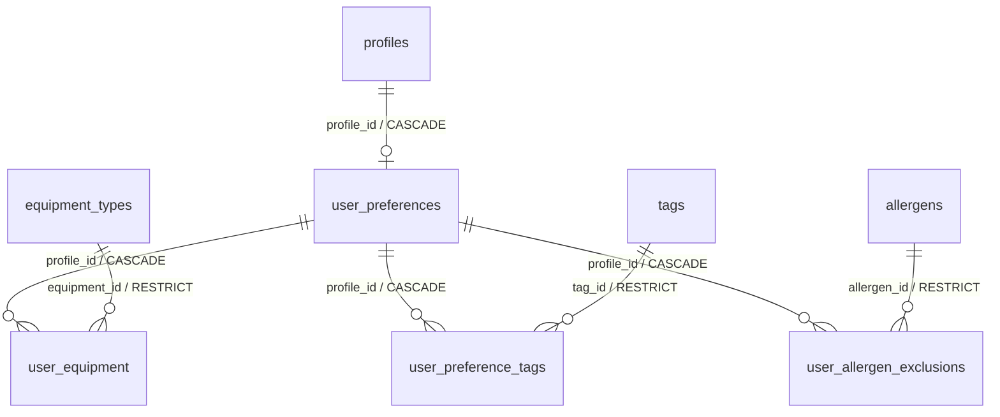

# Cookly — autentificare și profil

Etapa 3, 2 noiembrie 2026. Include cererea de autentificare/profil și fundația
Supabase/access de care depinde. [Fișiere](ACCESS-AUTH-FILES.md) ·
[Rezultate reale](AUTH-VERIFICATION.md) · [RLS](SUPABASE-SECURITY.md).

## Fluxuri și pagini

| Pagină                 | Comportament                                                                                               |
| ---------------------- | ---------------------------------------------------------------------------------------------------------- |
| `/login`               | Email/parolă, sesiune persistentă, redirect numai spre rute interne permise                                |
| `/register`            | Parolă de 12–128 caractere, confirmare, email; mesaj nediferențiat pentru cont existent                    |
| `/forgot-password`     | Solicitare link; nu confirmă existența contului                                                            |
| `/auth/resend`         | Retrimitere confirmare cu mesaj sigur                                                                      |
| `/auth/confirm`        | Validează token_hash/type și cere POST explicit înainte de consum; GET nu autentifică și nu schimbă parola |
| `/auth/reset-password` | Cere context de recuperare criptat, maximum 10 minute; apoi parolă nouă și revenire la login               |
| `/auth/mfa`            | Configurare/verificare TOTP, necesară accesului editorial și recuperării unui cont cu MFA                  |
| `/profile`             | Numai propriile date, opțiuni de profil, salvare atomică și logout                                         |

`/my-fridge`, `/meal-planner`, `/shopping-list`, `/favorites`, `/assistant`,
`/profile` și `/admin` verifică sesiunea și identitatea pe server înainte de conținut.
Admin cere și editor/admin + AAL2. O politică RLS rămâne autoritativă la orice
apel direct, inclusiv când cineva ocolește UI-ul. Paginile de business rămân
placeholder-e după autentificare; această etapă nu implementează matchingul.
`/`, `/recipes`, detaliul public și formularele de cont rămân publice.

## Sesiune și autorizare

Supabase Auth deține parolele și emite/revocă tokenurile; serverul Cookly folosește
API-ul Auth oficial prin fetch, cu cheia publishable. Nu stochează parole, nu
semnează JWT-uri de identitate și nu folosește chei secret/service role.

Browserul primește un cookie HttpOnly, SameSite=Lax, path `/`, cu maximum șapte
zile de valabilitate absolută. În HTTPS se folosește `__Host-cookly-session` și
Secure, inclusiv la ștergere. Local HTTP folosește `cookly-session`. Payloadul este
criptat/autentificat AES-256-GCM, nonce aleatoriu, cu cheie HKDF separată prin
scop și originea aplicației, derivată din CSRF_SECRET. Tokenurile access/refresh nu ajung în URL, localStorage, componente client,
state de formular sau mesaje de eroare.

Cookie-ul criptat nu înlocuiește verificarea identității: Auth `/user` verifică
tokenul, iar `api.actor_context()` furnizează rolurile/statusul curente. Subiecții
trebuie să coincidă. Nu se citește rolul din user_metadata/app_metadata sau body.
`requireRole` este server-only; DB repetă autorizarea și verificarea MFA.

Proxy-ul Next reînnoiește accesul înainte de expirare pentru navigări GET/HEAD,
propagă cookie-ul nou în cererea SSR și în răspuns. Server Actions care au nevoie
de identitate pot face refresh înaintea scrierii. Deadline-ul absolut de șapte
zile și cel de recuperare nu se extind la refresh. Nu există cache global de sesiuni.
La indisponibilitatea providerului se păstrează refresh credentialul, dar nu se
servește conținut privat fără verificare. Catalogul public nu este blocat de outage.

Logout încearcă refresh pentru un access token expirat, apoi revocă sesiunea la
provider și șterge cookie-ul local în orice caz. Dacă providerul nu răspunde,
revocarea externă nu este garantată; logout-ul local este făcut. După resetarea
parolei se încearcă revocarea globală. JWT-uri sau linkuri semnate deja emise nu
sunt prezentate ca fiind revocabile instantaneu de simpla ștergere a cookie-ului.

## Confirmare, recuperare și MFA

Template-urile din `supabase/templates` folosesc SiteURL și TokenHash. Pagina
primește numai hash-ul de verificare, nu access/refresh tokens în fragment. Butonul
explicit împiedică scanerele care doar deschid URL-ul să consume linkul prin GET.
Hash-ul rămâne o credențială de unică folosință: configurați și infrastructura să
nu logheze query-urile `/auth/*`. Răspunsurile Auth au no-referrer/no-store și noindex.

Verificarea de tip recovery marchează sesiunea criptată pentru maximum 600 secunde.
O sesiune obișnuită nu poate seta acest marker. Resetarea reverifică identitatea
și markerul; o vizită directă fără context merge la recuperare. Pentru conturi cu
TOTP verificat, fluxul cere AAL2 înainte de modificarea parolei și revine numai la
destinația internă fixă `/auth/reset-password`. Challenge-ul MFA păstrează deadline-ul.
Pierderea factorului verificat necesită procesul de recuperare administrativ;
parola/emailul nu ocolesc MFA.

TOTP este configurat prin introducerea manuală a cheii în aplicația de autentificare
și verificarea codului de șase cifre. Cheia este afișată numai utilizatorului
autentificat, nu este salvată în profil/cookie/log. Reluarea configurării șterge
numai factorii proprii Cookly TOTP neverificați, apoi creează unul nou; nu elimină
factori verificați. QR, SMS, OAuth și administrarea multiplilor factori nu sunt incluse.

Server Actions verifică Origin exact față de APP_BASE_URL, pe lângă protecția
Next.js. Limita payloadului este 32 KiB; Zod validează câmpurile, parolele,
datele profilului și destinațiile. Erorile providerului nu sunt returnate brut.
Signup/recovery/resend nu afirmă că o adresă este înregistrată. Rate limits ale
providerului sunt respectate; înainte de producție se configurează SMTP, rate
limits la ingress și protecția anti-abuz/captcha potrivită deploymentului.

## Profil și migrația 08

Decizie confirmată de utilizator: **buget per masă**, pentru toate persoanele din
profil, cu monedă explicită. Bugetul este opțional, strict pozitiv dacă e completat,
maximum 999999.99, cel mult două zecimale; nu este un plafon per persoană sau săptămână.

- `profiles`: nume afișat, limbă `ro-RO/en-GB`, fus orar valid.
- `user_preferences`: persoane 1–20, `meal_budget` zecimal, moneda MDL/RON/EUR/USD.
- `user_preference_tags`: selecție numai din taguri `diet`.
- `user_allergen_exclusions`: alergeni selectați, fără date publice despre persoană.
- `equipment_types`, `user_equipment`: dicționar comun și selecție proprie N:N.

Seed-urile sunt dicționare mici de opțiuni, nu dataset de rețete/nutriție.
Schema curentă are 37 de tabele, toate cu FORCE RLS. Cele două tabele noi au
politici proprii și index invers pentru FK-ul echipamentului.

`profile_options()` este public și întoarce doar dicționare. `get_my_profile()`
cere actor activ și nu acceptă user ID. `save_my_profile(...)` validează selecțiile,
blochează profilul/preferințele și salvează toate câmpurile/join-urile într-o singură
tranzacție. Owner și rol nu sunt parametri. Un input invalid face rollback complet.
Pentru aceste preferințe se aplică ultima salvare completă; nu există merge de
formulare concurente. Bugetul traversează DTO ca șir zecimal, nu float.

Limba este salvată ca preferință; traducerea întregului UI nu este implementată.
Preferințele/alergenii nu sunt încă conectate la matching, care aparține altei sarcini.

## Configurare și demonstrare

1. Pornește un stack Supabase local nou, conform [configurării](SUPABASE-SECURITY.md),
   și aplică **toate** migrațiile 01–08. Nu activa Auth peste o schemă parțială.
2. Completează `.env.local` cu API URL, publishable key, APP_BASE_URL exact și
   CSRF_SECRET generat local cu `openssl rand -base64 32`. Nu publica această valoare.
   Originea implicită documentată este `http://127.0.0.1:3000`; HTTPS în producție.
3. Auth local folosește template-urile versionate și mailul local la port 54324.
   Pe hosted, copiază template-urile în Auth Email Templates și setează Site URL,
   confirmarea emailului, TOTP și redirecturi exacte. Config.toml nu schimbă hosted.
4. Rulează `npm run dev`, înregistrează un cont și confirmă din email. Salvează
   profilul, reîncarcă pagina și redeschide browserul pentru persistență.
5. Creează un al doilea cont pentru a verifica izolarea. Încearcă direct RPC-uri
   cu ID-uri străine și rol fals în metadate. Nu folosi cheia service role ca client.
6. Recuperează parola, inclusiv pentru un cont cu MFA, apoi verifică login/logout.
   Atribuirea rolului editorial este o operație a administratorului de încredere,
   nu un câmp din profil.

## Verificări și limite de execuție

Testele unitare folosesc stub-uri doar la limita HTTP externă. Testele SQL de
izolare sunt scrise pentru PostgreSQL PGlite cu fixture-uri locale. E2E include
redirecturile anonime, formularele publice, contextul reset și eroarea de validare.
Buildul și smoke-ul în proces nu dovedesc funcționarea SMTP, rotația refresh-token,
RLS live sau Storage. Rezultatele reale sunt în [AUTH-VERIFICATION.md](AUTH-VERIFICATION.md).

Rămân de verificat pe servicii pornite: emailuri reale locale, MFA complet, refresh
simultan din mai multe taburi, expirare/revocare, toate politicile și cascadele,
profil A/B, tastatură, mobil și light/dark. Cookie-ul are limită 3800 caractere;
răspunsurile Auth anormal de mari sunt refuzate, fără trunchiere de token.

Surse primare pentru integrare:
[Password Auth](https://supabase.com/docs/guides/auth/passwords),
[Email Templates](https://supabase.com/docs/guides/auth/auth-email-templates),
[verifyOtp](https://supabase.com/docs/reference/javascript/auth-verifyotp),
[Next Proxy](https://nextjs.org/docs/app/api-reference/file-conventions/proxy).
