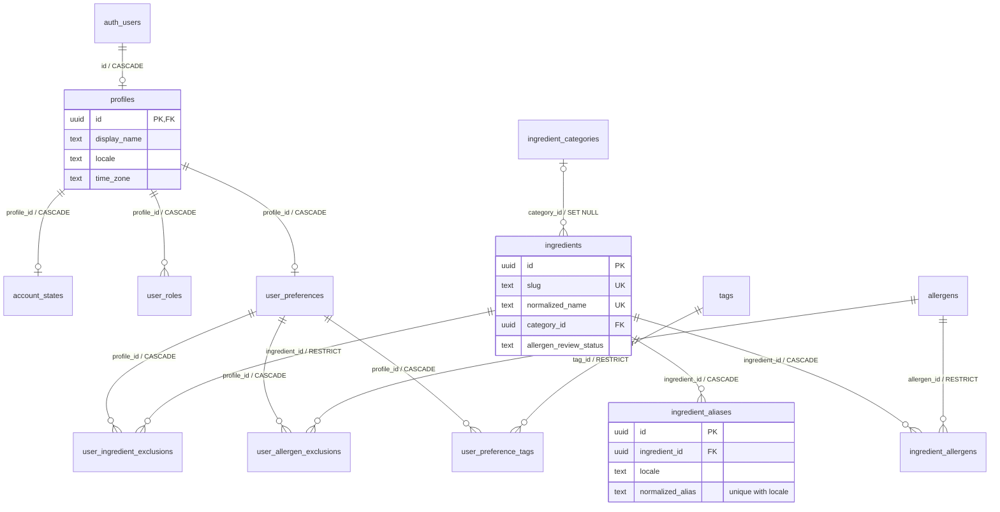
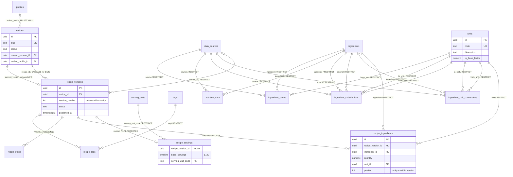
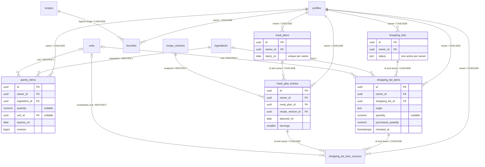
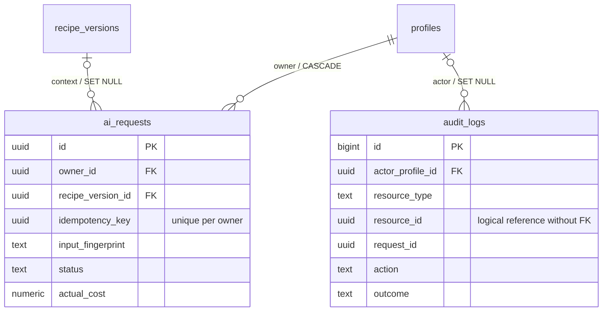

# Cookly — schema PostgreSQL

Etapa 3 · Schema bazei de date · 1 noiembrie 2026.

Acest document descrie snapshotul inițial 01–04. Accesul adăugat ulterior este
în [SUPABASE-SECURITY.md](SUPABASE-SECURITY.md), iar extensia profilului în
[AUTH-PROFILE.md](AUTH-PROFILE.md). Schema curentă are 37 de tabele.

**Livrat:** 35 de tabele în `app_private`, patru migrații SQL, ERD și teste de
integritate. `api` este rezervată, fără endpointuri sau funcții publice. Nicio
migrație nu conectează UI-ul, nu importă date externe și nu apelează AI.

Documente de referință: [arhitectură](../architecture/ARCHITECTURE-Cookly.md),
[convenții](../architecture/PROJECT-STRUCTURE.md), [PRD](../product/PRD-Cookly.md),
[verificare](VERIFICATION.md).

## 1. Convenții și tipuri

- PostgreSQL **15+**, proiect Supabase nou. `auth.users(id)` și rolurile standard
  există înaintea migrațiilor. Nu creăm obiecte în schemele gestionate de Supabase.
- UUID pentru identități; `audit_logs.id` folosește `bigint identity`. UUID nu este
  dovadă de autorizare. Join-urile N:N au PK compus; profilul, preferințele, starea
  contului și porțiile au PK care este și FK.
- `snake_case`, FK cu sufix `_id`, timp absolut în `timestamptz`; `date` pentru
  expirare, măsurători și planificare în fusul utilizatorului. Fără conversie
  automată a unei zile locale în UTC. Datele de planificare sunt finite.
- `quantity`: `numeric(18,6)` finit, nenegativ; rețetele și contribuțiile cunoscute
  cer strict pozitiv. `positive_factor`: `numeric(24,12)` finit, pozitiv.
  `amount`: `numeric(18,8)` finit, nenegativ. Fără `float` pentru cantități sau bani.
  Peste scala declarată PostgreSQL rotunjește: validarea viitoare Zod trebuie să
  controleze precizia înaintea scrierii. În DTO-uri, zecimalele se transportă ca
  șiruri, iar `bigint` nu se convertește necontrolat la JavaScript `number`.
- `NULL` = necunoscut. În inventar și cumpărături, cantitatea și unitatea sunt
  împreună prezente sau absente. Zero în inventar = lot epuizat. Lista de cumpărături
  acceptă numai necesar cunoscut strict pozitiv sau necesar necunoscut.
- `created_at` există peste tot. Tabelele editabile au `updated_at`, actualizat
  prin trigger, cu păstrarea datei inițiale. Join-urile simple și înregistrările
  de proveniență au numai `created_at`. Agregatele personale editabile au
  `revision`, incrementat de DB indiferent de valoarea trimisă de client.
- `text + CHECK` pentru vocabular controlat: extinderea unui status necesită o
  migrație explicită. `CHECK` nu înlocuiește autorizarea sau un workflow de serviciu.
- Toate FK au acțiune de ștergere explicită. Indexuri B-tree pe FK și căile de
  acces; indexurile PK/UNIQUE nu sunt dublate inutil. Excepțiile/redundanțele
  compuse pentru ownership sunt intenționate.

Comportamentul `NULL`, verificările și acțiunile FK urmează
[constrângerile PostgreSQL](https://www.postgresql.org/docs/15/ddl-constraints.html).
Tipurile zecimale și valorile speciale sunt descrise în
[numeric](https://www.postgresql.org/docs/15/datatype-numeric.html).

## 2. ERD

Diagramele sunt împărțite pe domenii. O entitate repetată este același tabel;
referințele `owner_id` sunt redate explicit și sunt explicate în secțiunea 3.
`auth_users` reprezintă tabelul extern gestionat `auth.users`.

### Identitate, ingrediente și preferințe



### Catalog, versiuni, surse și măsurători



### Inventar, planificare și cumpărături



### AI și audit



## 3. Dicționar și explicația relațiilor

`C` = `ON DELETE CASCADE`, `R` = `RESTRICT`, `N` = `SET NULL`.
Un copil cu FK `NOT NULL` are exact un părinte; un FK nullable permite 0 sau 1.
Părinții pot avea 0..N copii, exceptând relațiile PK-FK 0..1 menționate.

### Identitate și catalog comun

| Tabel                   | Relație și scop                                                       | Unicitate / ștergere                                              |
| ----------------------- | --------------------------------------------------------------------- | ----------------------------------------------------------------- |
| `profiles`              | PK `id` → `auth.users.id`; profilul aplicației, fără parolă/email/rol | 1:0..1, C. Provisionarea profilului nu este implementată          |
| `account_states`        | PK `profile_id` → profiles; suspendare separată de profilul editabil  | 1:0..1, C                                                         |
| `user_roles`            | `profile_id` → profiles; roluri editor/moderator/admin                | PK `(profile_id, role)`, C; absența rolului = utilizator obișnuit |
| `units`                 | Dicționar de unități pentru masă, volum și număr                      | `code` unic; cel mult o bază/dimensiune; baza are factor 1        |
| `serving_units`         | Dicționar separat pentru porție/bucată de produs finit                | PK `code`; nu echivalează o porție cu grame                       |
| `ingredient_categories` | Clasificare simplă, fără arbore în MVP                                | `slug` unic                                                       |
| `ingredients`           | `category_id` opțional → categorii                                    | N la categorie; slug și nume normalizat unice                     |
| `ingredient_aliases`    | `ingredient_id` → ingredients, 1:N; sinonime localizate               | C; `(locale, normalized_alias)` unic                              |
| `allergens`             | Dicționar de alergeni, fără date medicale despre persoane             | `code` unic                                                       |
| `ingredient_allergens`  | N:N ingredients ↔ allergens; `contains` / `may_contain`               | PK pereche; ingredient C, alergen R                               |
| `data_sources`          | Proveniență, licență și atribuire pentru catalog/măsurători           | `code` unic; sursa folosită nu se șterge                          |
| `tags`                  | Etichete dietă/bucătărie/general                                      | `slug` unic; clasificarea nu certifică absența unui alergen       |

Normalizarea reduce spațiile și literele mari, fără transliterare, căutare fuzzy
sau unificare semantică. Un alias nu poate indica două ingrediente în aceeași
limbă, dar SQL nu verifică suprapunerea aliasurilor cu numele canonice din alt
tabel. Resolverul viitor trebuie să trateze ambiguitatea, fără asociere implicită.
`allergen_review_status='unknown'` nu înseamnă „fără alergeni”.

### Rețete, porții, conversii și măsurători

| Tabel                         | Toate referințele / relația                                                                             | Constrângeri și ștergere                                                                                            |
| ----------------------------- | ------------------------------------------------------------------------------------------------------- | ------------------------------------------------------------------------------------------------------------------- |
| `recipes`                     | autor opțional → profiles; versiune curentă opțională → recipe_versions                                 | autor N; FK compus `(id,current_version_id)` → `(recipe_id,id)`, NO ACTION amânat; slug unic                        |
| `recipe_versions`             | `recipe_id` → recipes, 1:N; `source_id` opțional → data_sources                                         | rețetă C pentru drafturi, sursă R; `(recipe_id,version_number)` unic; `(recipe_id,id)` unic pentru pointerul compus |
| `recipe_servings`             | PK `recipe_version_id` → versiune; `serving_unit_code` → serving_units                                  | versiune 1:0..1 în draft și exact 1 la publicare, C; unitate R; 1–20 porții                                         |
| `recipe_ingredients`          | versiune → recipe_versions; ingredient → ingredients; unitate → units                                   | versiune C, ingredient/unitate R; poziție unică în versiune; cantitate >0                                           |
| `recipe_steps`                | versiune → recipe_versions, 1:N ordonat                                                                 | C; `(recipe_version_id,step_number)` unic; instrucțiune nevidă                                                      |
| `recipe_tags`                 | N:N recipe_versions ↔ tags                                                                              | PK pereche; versiune C, tag R                                                                                       |
| `ingredient_unit_conversions` | ingredient → ingredients; `from_unit_id`, `to_unit_id` → units; sursă → data_sources                    | toate R; `(ingredient,from_unit,to_unit)` unic; unități diferite, factor >0 și dată                                 |
| `ingredient_substitutions`    | ingredient inițial și înlocuitor → ingredients; unități de intrare/ieșire → units; sursă → data_sources | toate R; pereche direcțională cu unități unică; ingredient diferit; ratio >0                                        |
| `nutrition_data`              | ingredient → ingredients; sursă → data_sources                                                          | ambele R; identificator sursă și revizie unice/ingredient; cel puțin o valoare cunoscută                            |
| `ingredient_prices`           | ingredient → ingredients; sursă → data_sources; unitate de referință → units                            | toate R; identificator/revizie/regiune/monedă unice în sursa ingredientului; bază >0                                |

Un ingredient poate apărea în mai multe poziții ale aceleiași rețete: ingrediente
pentru aluat și umplutură nu sunt contopite la stocare. Numărul pasului/poziția
trebuie să fie pozitiv și unic, dar nu obligatoriu contiguu în draft.

`recipes` este identitatea din URL și favorite. `recipe_versions` este conținutul
de referință. Publicarea cere porții, minimum un ingredient obligatoriu și un
pas; triggerul setează `published_at`. După publicare, orice modificare/ștergere
a versiunii sau a celor patru colecții copil este refuzată. Schimbările se fac
printr-un draft nou. Ștergerea fizică a unei rețete cu versiune publicată este
refuzată chiar dacă FK-ul de bază este CASCADE; retragerea folosește statusul
identității logice. Retragerea trebuie consultată inclusiv când un plan indică
o versiune veche. Pointerul curent acceptă numai propria versiune publicată.
Actualizarea lui se face după publicarea versiunii, în aceeași tranzacție.

Factorii de bază permit conversii în aceeași dimensiune. Conversiile specifice
ingredientului declară `valoare_ieșire = valoare_intrare × factor`, de exemplu
bucată → grame; lipsa măsurătorii blochează deducția exactă. Nu presupunem
densitate universală, lanțuri automate sau simetria substituțiilor. Nu există
verificare SQL a consistenței matematice a întregului graf de conversii; sursele
trebuie revizuite editorial. Substituirea cere recalcularea alergenilor și nutriției.

Nutriția este **per 100 g de parte comestibilă**, cu energie în kcal și restul în
grame; o valoare lipsă rămâne NULL. Nu impunem însumarea macronutrienților la 100:
fibrele și convențiile surselor se pot suprapune. Nu există total nutrițional
materializat pe rețetă. Prețurile sunt per cantitate/unitate, regiune ISO de două
litere, monedă de trei litere și dată. Regexurile verifică forma, nu apartenența
la registre ISO. Estimările trebuie să indice sursa, revizia și data; selectarea
sursei și politica de expirare se stabilesc înaintea implementării calculelor.

### Date personale și operaționale

| Tabel                        | Toate referințele / relația                                                                                                        | Constrângeri și ștergere                                                                                     |
| ---------------------------- | ---------------------------------------------------------------------------------------------------------------------------------- | ------------------------------------------------------------------------------------------------------------ |
| `user_preferences`           | PK profile_id → profiles                                                                                                           | 1:0..1, C; porții 1–20; timp maxim opțional pozitiv                                                          |
| `user_ingredient_exclusions` | N:N user_preferences ↔ ingredients                                                                                                 | PK pereche; preferințe C, ingredient R                                                                       |
| `user_allergen_exclusions`   | N:N user_preferences ↔ allergens                                                                                                   | PK pereche; preferințe C, alergen R                                                                          |
| `user_preference_tags`       | N:N user_preferences ↔ tags                                                                                                        | PK pereche; preferințe C, tag R; numai semnificația tagului este editorială                                  |
| `pantry_items`               | owner → profiles; ingredient → ingredients; unitate opțională → units                                                              | owner C; ingredient/unitate R; mai multe loturi permise; pereche `(id,owner_id)` unică                       |
| `favorites`                  | N:N profiles ↔ recipes, pe identitatea logică                                                                                      | PK `(owner_id,recipe_id)`; ambele C; retragerea rețetei nu șterge favoritul                                  |
| `meal_plans`                 | owner → profiles                                                                                                                   | C; `(owner_id,starts_on)` unic; `(id,owner_id)` unic                                                         |
| `meal_plan_entries`          | owner → profiles; `(meal_plan_id,owner_id)` → meal_plans; versiune → recipe_versions                                               | owner/plan C, versiune R; `(id,owner_id)` unic; 1–20 porții                                                  |
| `shopping_lists`             | owner → profiles                                                                                                                   | C; `(id,owner_id)` unic; cel mult o listă activă/owner                                                       |
| `shopping_list_items`        | owner → profiles; `(shopping_list_id,owner_id)` → shopping_lists; ingredient opțional → ingredients; unitate opțională → units     | owner/listă C, ingredient/unitate R; `(id,owner_id)` unic; grup generat unic incluzând unitatea NULL         |
| `shopping_list_item_sources` | owner → profiles; `(item_id,owner_id)` → shopping_list_items; `(entry_id,owner_id)` → meal_plan_entries; unitate opțională → units | primele trei C, unitate R; PK item/entry, N:N între articole și mese                                         |
| `ai_requests`                | owner → profiles; versiune de context opțională → recipe_versions                                                                  | owner C, versiune N; `(owner_id,idempotency_key)` unic; costuri/tokeni nenegativi și status/timpi corelați   |
| `audit_logs`                 | actor opțional → profiles                                                                                                          | actor N; `resource_id` este referință logică fără FK, astfel încât ștergerea resursei să nu distrugă auditul |

În tabelul de proveniență, numele reale ale coloanelor sunt
`shopping_list_item_id` și `meal_plan_entry_id`. FK compuse verifică **același
proprietar**, nu doar existența UUID-ului părintelui. Cheile directe spre profil
permit ștergerea contului și indexarea/viitoarea autorizare a fiecărui tabel.

Planurile sunt ferestre de șapte zile cu început explicit, fără cerință de luni.
O intrare trebuie să cadă în fereastra părintelui; mutarea ferestrei nu poate
lăsa intrări în afară. Pot exista mai multe preparate în același slot. Planuri cu
date de început diferite se pot suprapune; detectarea conflictelor va fi o regulă
de produs, dacă va fi cerută. Adăugarea/schimbarea rețetei cere o versiune
publicată a unei rețete disponibile; retragerea ulterioară păstrează intrarea.

Articolele manuale pot avea doar etichetă, fără ingredient canonic. Cele generate
cer ingredient canonic și au cel mult un grup ingredient/unitate în listă,
inclusiv când unitatea e necunoscută (`NULLS NOT DISTINCT`, PostgreSQL 15+).
`purchased_quantity` este parțialul cumpărat, în unitatea articolului, între zero
și necesar; pentru necesar necunoscut rămâne zero. `checked_at` este marcajul
explicit al utilizatorului, independent de consum/stoc. Bifarea nu modifică
inventarul. Regenerarea trebuie să păstreze progresul sau să ceară o decizie dacă
necesarul scade sub cantitatea cumpărată; CHECK-ul refuză pierderea implicită.

Ștergerea unei mese elimină legăturile sale de proveniență, **nu recalculează**
cantitatea deja salvată în articol. Serviciul viitor trebuie să regenereze în
aceeași tranzacție. FK-urile nu verifică formula cantității, conversia unităților
sau că articolul corespunde unui ingredient al rețetei; acestea sunt invariabile
ale operației de generare, care nu este implementată aici.

`ai_requests` nu este un queue/worker complet și nu conține prompturi sau rezultate
brute. Păstrează identificarea cererii, amprenta inputului, versiunea promptului,
contextul, metadatele de consum și starea. Refolosirea aceleiași chei cu alt input
trebuie respinsă de viitorul serviciu, comparând fingerprintul. Cancelarea pending
poate să nu aibă `started_at`, dar trebuie să aibă `completed_at`. Nu este activat
niciun furnizor și nu se promite procesare exact o dată.

Auditul nu are JSON liber, email, IP, token sau prompt. `resource_id` poate fi
totuși pseudonim identificabil: nulificarea actorului **nu garantează** anonimizarea
completă. Retenția și ștergerea selectivă cer o politică explicită de mentenanță.
Nu există trigger automat de audit al tuturor operațiilor; scrierea evenimentelor
în tranzacția de business aparține etapei API/securitate.

## 4. Indexuri și interogări anticipate

| Acces                       | Indexuri / justificare                                                                                                 |
| --------------------------- | ---------------------------------------------------------------------------------------------------------------------- |
| Lookup ingrediente/aliasuri | UNIQUE pe slug/nume normalizat și `(locale,normalized_alias)`; index categorie; fără motor full-text prematur          |
| Matching după ingredient    | `recipe_ingredients(ingredient_id,recipe_version_id)`; ordine după versiune/poziție prin UNIQUE                        |
| Catalog publicat            | index parțial recipes `(updated_at DESC,id)` unde published; versiunile indexate prin recipe/version                   |
| Alergeni/taguri/excluderi   | PK pe prima parte a join-ului, index invers pe a doua parte                                                            |
| Frigider                    | owner/ingredient; owner/expirare/id doar loturi nearchivate; indexuri FK ingredient/unitate                            |
| Plan                        | UNIQUE owner/start; intrări plan/owner/zi și owner/zi; index versiune pentru FK                                        |
| Cumpărături                 | index parțial unic owner activ; listă/owner pe articole; grup generat unic; index invers de proveniență pe entry/owner |
| Nutriție/preț               | ingredient și dată desc; pentru preț și regiune/monedă; indexurile sursă/unitate susțin FK și selecția                 |
| AI                          | owner/dată/id, cheie idempotentă unică, index parțial pending/running, FK versiune                                     |
| Audit                       | actor/timp, resursă/timp, request_id, timp pentru retenție                                                             |

Indexurile sunt propuneri executabile, fără afirmații de performanță măsurată.
EXPLAIN ANALYZE, volume, dimensiunea indexurilor și eventuala căutare GIN/trigram
se validează cu date reprezentative. Nu sunt introduse extensii, tabele
partiționate sau cache-uri de matching fără dovezi de necesitate.

## 5. Tranzacții, ștergere și securitate

- Publicarea și editarea copiilor scriu aceeași versiune-părinte, ca să nu poată
  trece simultan verificarea de completitudine și o ștergere a ingredientelor.
  Intrările din plan scriu părintele înainte de verificarea intervalului.
  Actualizările de părinte pot modifica `updated_at`/`revision` fără schimbare de
  conținut; este intenționat. La `40001` și `40P01`, viitorul serviciu trebuie să
  reia **întreaga** tranzacție cu limită și ordine stabilă a resurselor.
- Fiecare versiune personală `revision` este un token de concurență al rândului,
  nu o garanție că orice copil schimbă automat revizia agregatului. Serviciile
  trebuie să folosească `UPDATE ... WHERE revision = :expected` și să atingă
  părintele când workflow-ul are nevoie de o revizie agregată.
- Ștergerea `auth.users` cascadează profilul și datele personale; autorul
  rețetei și actorul auditului devin NULL. Catalogul publicat rămâne. Obiectele
  Storage, backupurile, procesările externe și retenția nu sunt gestionate de FK.
- Catalogul folosit este arhivat/dezactivat, nu șters. Categoria este metadată
  opțională și poate fi ștearsă fără pierderea ingredientului. Sursele și unitățile
  folosite sunt RESTRICT. Conținutul publicat nu se rescrie pentru anonimizarea
  autorului: autorul este numai pe identitatea logică.
- Toate tabelele au ENABLE + FORCE RLS și **zero politici permisive** în această
  etapă. USAGE, drepturile pe tabele/secvențe și EXECUTE pe funcții sunt revocate
  pentru PUBLIC/anon/authenticated/service_role. Inclusiv service_role nu trebuie
  să primească acces implicit, deși rolurile BYPASSRLS pot ocoli RLS dacă au grants.
- Funcțiile sunt `SECURITY INVOKER`, cu `search_path=''` și tabele calificate.
  Proprietarul/superuserul poate administra schema; RLS nu este protecție față de
  superuser. Nu se configurează schema `app_private` ca schemă expusă în Data API.
- Per-schema `ALTER DEFAULT PRIVILEGES ... REVOKE EXECUTE FROM PUBLIC` **nu**
  anulează default-ul global PostgreSQL. Fiecare migrație ulterioară care creează
  funcții trebuie să includă revocarea explicită în aceeași tranzacție, înainte
  de grants minime. Nu schimbăm global default-urile rolului administrativ
  Supabase, pentru a nu afecta alte scheme gestionate.
- Viitoarele RPC-uri vor avea rol dedicat NOLOGIN fără BYPASSRLS sau ownership,
  politici și grants limitate. Această etapă nu creează rolul sau politicile de
  acces. Un client Supabase autentificat nu poate încă folosi tabelele Cookly.

Referințe pentru aceste limite:
[RLS Supabase](https://supabase.com/docs/guides/database/postgres/row-level-security),
[profil legat de PK auth.users](https://supabase.com/docs/guides/auth/managing-user-data),
[default privileges PostgreSQL](https://www.postgresql.org/docs/current/sql-alterdefaultprivileges.html).

## 6. Aplicarea migrațiilor și verificare

Ordinea este fixată de numele fișierelor:

1. `20261101000001_foundation.sql` — scheme, tipuri, identitate, unități și taxonomie.
2. `20261101000002_catalog.sql` — rețete versionate, conversii, substituții, nutriție/preț.
3. `20261101000003_personal.sql` — preferințe, inventar, favorite, plan, cumpărături, AI/audit.
4. `20261101000004_invariants_and_security.sql` — triggeri, RLS, revocarea accesului.

Fișierele nu includ BEGIN/COMMIT: runnerul controlează tranzacția. Prima instalare
trebuie aplicată integral înaintea folosirii aplicației, fără fereastră de acces
între migrații. Pe un proiect Supabase de dezvoltare **nou și fără date**, după
verificarea conexiunii administrative, toate cele patru pot fi aplicate atomic:

```sh
psql "$COOKLY_DATABASE_URL" -X -v ON_ERROR_STOP=1 --single-transaction \
  --file supabase/migrations/20261101000001_foundation.sql \
  --file supabase/migrations/20261101000002_catalog.sql \
  --file supabase/migrations/20261101000003_personal.sql \
  --file supabase/migrations/20261101000004_invariants_and_security.sql
```

`COOKLY_DATABASE_URL` este o variabilă locală a operatorului, nu configurație
publică Next și nu se comite. Comanda de mai sus este documentată, nu executată
pe un serviciu conectat. Pentru un proiect deja folosit, reconcilierea istoricului
de migrații trebuie făcută înaintea aplicării. Fișierele nu folosesc `CREATE TABLE
IF NOT EXISTS`: nepotrivirile trebuie să eșueze vizibil. Nu există „down migration”
distructivă automată; o corecție se face prin migrație nouă și backup/restore testat.

Testele izolate se rulează cu `npm run test:db`; runnerul creează o instanță
PGlite în memorie, fără URL sau credențiale, execută fixture-ul minimal `auth` și
rolurile, apoi migrațiile în ordine. Fiecare scenariu are date sintetice și
ROLLBACK. **`tests/database/bootstrap.sql` nu se aplică pe Supabase.** Fixture-ul
nu reproduce întregul Auth/Storage/PostgREST.

PGlite este o dependență numai pentru teste și folosește un singur backend;
nu certifică integrarea Supabase sau concurența între sesiuni. API-ul său de
execuție SQL este documentat în [PGlite](https://pglite.dev/docs/).
Rezultatele reale și eventualele blocaje se află în [VERIFICATION.md](VERIFICATION.md).

## 7. Decizii de validat și limite asumate

1. Sursele/licențele pentru rețete, nutriție și preț; selecția reviziei de referință
   și intervalele de prospețime. Niciun dataset real nu este inclus.
2. Lista finală de alergeni, unitățile suplimentare și conversiile revizuite;
   `piece` nu stabilește greutatea unui ingredient. Semantica dietelor nu este
   echivalentă cu siguranța pentru alergii.
3. Limitele MVP 1–20 porții, maxim șapte zile/plan, posibilitatea planurilor
   suprapuse și lista unică activă per cont; fără gospodării partajate.
4. Retenția AI/audit, anonimizarea referințelor logice, restaurarea backupurilor și
   ștergerea Storage. Jurnalele nu sunt o arhivă imuabilă legală.
5. Schema viitoare pentru confirmarea gătitului, compensări de stoc și idempotenta
   regenerării listei. Nu există rezervări, deduceri sau ledger de consum acum;
   aceste fluxuri vor necesita migrații și tranzacții dedicate.
6. Nutriție/preț pentru ingrediente „după gust”, randament de gătire și produse
   finite. Modelul actual cere cantități numerice pentru ingredientele rețetei;
   nu inventează grame/valoare nutrițională dintr-o porție.
7. RLS/RPC, provisioning Auth, Storage și generarea tipurilor DB TypeScript în
   etapa lor separată. UI-ul păstrează stările existente loading/empty/error;
   nu adăugăm interacțiuni DB sau tipuri TS manuale care pot devia de la SQL.
8. Concurența multi-sesiune trebuie verificată pe versiunea PostgreSQL a
   proiectului Supabase, inclusiv publicare vs. editare, schimbarea săptămânii
   vs. adăugarea mesei și retry după serializare/deadlock.
