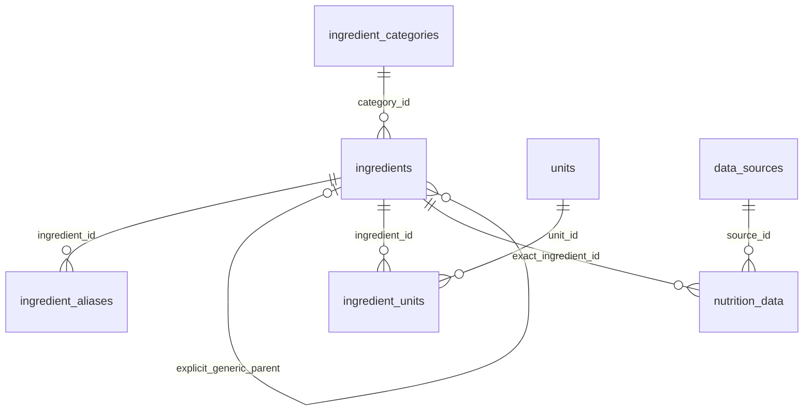

# Cookly — catalog de ingrediente

Etapa 4, catalog public accesibil la `/ingredients`, fără cont. Pagina `/recipes`
trimite către catalog; matchingul, inventarul și editarea editorială nu fac parte
din această sarcină. Rezultatele reale de verificare sunt în [VERIFICATION.md](VERIFICATION.md),
iar inventarul fișierelor în [FILES.md](FILES.md).

## Identitate și date inițiale

[ingredients-v1.json](../data/ingredients-v1.json) conține 32 de identități editoriale,
în 9 categorii. Migrația 10 include același JSON; un test verifică paritatea. Fiecare
ingredient are UUID, slug stabil, nume canonic român, aliasuri în română/rusă/engleză,
categorie și unități permise. Primul alias al fiecărei limbi este preferat pentru
afișare. Categoria, unitățile și textele interfeței rămân în română; `locale` schimbă
denumirea ingredientului, nu traduce întreaga aplicație.

Identitatea este UUID-ul, nu textul normalizat. `pui` este alias explicit pentru
`carne-de-pui`; `piept-de-pui` are alt UUID. Căutarea `pui` poate întoarce ambele
identități, dar selectarea uneia nu o selectează automat pe cealaltă. `generic` și
`specific` sunt niveluri editoriale relative, nu certificări de precizie nutrițională.

Relațiile `part_of` și `variant_of` sunt declarate numai pentru cele patru perechi
din seed: piept/pui, orez alb/orez, făină de grâu/făină și lapte de vacă/lapte.
FK-ul compus impune un părinte generic; părinții generici nu au părinți. Nu există
cicluri, extindere automată a căutării după părinte, moștenire de nutrienți sau
substituție culinară. Aliasurile nu unesc identități cu nume asemănătoare.



Unitățile permise sunt masă (`g`, `kg`), volum (`ml`, `l`) sau număr (`piece`), cu
cel mult o unitate implicită pe ingredient. Catalogul nu calculează conversii.
Nu există factor bucăți→grame sau volum→masă, densități ori greutăți medii inventate.

Traducerile și aliasurile sunt redactate pentru acest proiect și necesită revizie
lingvistică/editorială. Catalogul este un punct de pornire, nu o bază exhaustivă.
Forma crud/gătit, procentul de grăsime și varietatea nu sunt complet modelate în
toate denumirile. Acestea trebuie clarificate înaintea atașării unor valori nutritive.

## Nutriție și proveniență

**Seed-ul nu conține nicio valoare nutrițională numerică.** Nu a fost disponibilă
o înregistrare primară verificată pentru identitățile exacte; datele necunoscute
sunt `null` și `status: unavailable`, niciodată zero. Nu se copiază valori din memorie.

RPC-ul publică numai rânduri `verification_status='verified'` pentru ingredientul
specific cerut, cu `verified_at`, descrierea alimentului, sursă HTTP(S), licență,
identificator/revizie de înregistrare și dată de observație. Constrângerile existente
validează valori nenegative și limitele per 100 g. DTO-ul Zod verifică și coerența:
`partial` are 1–5 valori cunoscute, `available` toate cele șase, iar `unavailable`
nicio valoare/sursă. Decimalele sunt serializate ca șiruri pentru a păstra precizia.

Selectarea unei surse dintre mai multe este deterministă: observația cea mai recentă,
apoi revizia și UUID-ul. Nu se combină nutrienți din surse diferite pentru a umple
goluri. În interfață apar descrierea alimentului, sursa și data. Nutriția nu este
moștenită de la un părinte generic și nu este convertită automat în porții sau ml.

Marcajul `verified` reprezintă o decizie editorială privilegiată, nu verificare
automată. Înainte de publicare trebuie confirmate alimentul/prepararea, baza de
100 g, unitățile, licența și fiecare valoare. API-ul acestui feature este numai de
citire; nu există importator extern sau formular de administrare în această etapă.
Fixture-ul numeric din testul SQL este sintetic și nu este încărcat de migrații.

Surse primare pentru o viitoare verificare editorială: [USDA FoodData Central](https://fdc.nal.usda.gov/api-guide/)
și [CoFID](https://www.gov.uk/government/publications/composition-of-foods-integrated-dataset-cofid).
Aceste linkuri nu înseamnă că seed-ul a fost importat sau certificat de furnizori.

## Căutare și paginare

- NFC și lowercase; ș/ş→s, ț/ţ→t, ă/â→a, î→i. În rusă ё→е, dar й rămâne distinct de и.
- Punctuația acceptată este tratată ca separator. Nu se transliterează rusa în latină
  și nu se corectează greșeli de tastare prin distanță fuzzy.
- Toate aliasurile sunt căutate indiferent de limba etichetei. Tokenurile trebuie
  să fie prefixe de cuvinte din același nume/alias; `piept pui` poate găsi `Piept de pui`.
- Ordine: nume canonic exact, alias exact, prefix de expresie canonic/alias, apoi
  prefixe de cuvinte canonic/alias. Un UUID apare o singură dată pe pagină.
- Sortare stabilă după rang, numele canonic normalizat cu collation C și UUID.
  Paginarea este keyset, fără offset. Schimbarea limbii nu schimbă ordinea canonică.

Cheile și vectorii sunt coloane generate. Indexurile GIN acoperă documentele FTS
de nume/alias; există indexuri pentru chei, ingrediente active, categorii, relații
și date nutritive verificate. Nu este necesară extensia `unaccent`/`pg_trgm`.
Optimizarea planurilor și pragurile de latență necesită `EXPLAIN (ANALYZE, BUFFERS)`
pe volum realist; existența indexurilor nu reprezintă un benchmark.

Cursorul base64url include versiunea formatului, poziția și revizia catalogului;
un hash SHA-256 îl leagă de termenul normalizat, limbă, categorie și limită.
Nu este semnat și nu este un mecanism de autorizare: datele sunt publice, iar
forjarea unei poziții poate doar schimba porțiunea de catalog afișată. Cursorii
incompatibili sunt respinși. O modificare a catalogului invalidează continuarea
cu `409 CATALOG_CHANGED`, fără amestecarea reviziilor.

Revizia este crescută tranzacțional de triggere statement-level la INSERT/UPDATE/
DELETE/TRUNCATE în cele șapte tabele relevante. Rolul NOLOGIN al triggerului are
numai SELECT/UPDATE pe contor, cu RLS; nu primește drept de scriere în catalog.
Contorul global este simplu pentru un catalog rar modificat; importurile masive
și concurența ridicată pot cere o strategie de snapshot separată.

## API public

| GET                              | Parametri                                          | Rezultat                                       |
| -------------------------------- | -------------------------------------------------- | ---------------------------------------------- |
| `/api/v1/ingredients`            | `query`, `locale`, `categoryId`, `limit`, `cursor` | `items`, `catalogVersion`, `nextCursor`        |
| `/api/v1/ingredients/categories` | niciunul                                           | categorii cu ingrediente active                |
| `/api/v1/ingredients/{UUID}`     | `locale`                                           | sumar, aliasuri, unități, nutriție/proveniență |

`query` este opțional/gol pentru browsing; altfel minimum 2 caractere, maximum
80 și 8 cuvinte. `locale`: `ro-RO` implicit, `ru-RU`, `en-GB`. `limit`: 20 implicit,
1–50. `categoryId` și identificatorul de detaliu sunt UUID. Parametrii necunoscuți
sau duplicați ai căutării și detaliului sunt respinși; cursorul are maximum 1024
caractere. `nextCursor: null` indică ultima pagină. Nu trimite offset.

```sh
curl --get 'http://127.0.0.1:3000/api/v1/ingredients' --data-urlencode 'query=помидоры' --data-urlencode 'locale=ro-RO' --data-urlencode 'limit=5'
curl 'http://127.0.0.1:3000/api/v1/ingredients/categories'
```

Erorile au `{error: {code, message, requestId}}`: 400 `INVALID_QUERY`/
`INVALID_CURSOR`, 404 `NOT_FOUND`, 409 `CATALOG_CHANGED`, 503 `UNAVAILABLE`.
Mesajele SQL, URL-urile upstream și credențialele nu ajung în răspuns. Fiecare
răspuns are `X-Request-Id`, `nosniff` și `Cache-Control: no-store`.

## Arhitectură și acces

Route Handler → composition root → application service → repository port → adaptor
Supabase REST/RPC. Contractele Zod sunt publice/browser-safe; codec-ul și accesul
la date sunt `server-only`. Pagina este un RSC care montează insula client necesară
autocomplete-ului. API-ul public nu depinde de sesiune.

Transportul folosește numai cheia publishable, fără Authorization/Cookie din cererea
utilizatorului, fără service role, fără redirecturi, cu timeout 5 s și răspuns limitat
la 256 KiB. Căile RPC sunt allowlist. RLS rămâne activ; anon/authenticated au numai
SELECT pe noile tabele și EXECUTE pe RPC-urile de citire SECURITY INVOKER, cu search_path
fix. Vederile Data API istorice rămân compatibile: pot expune referințe inactive
necesare datelor vechi; noile RPC-uri de catalog filtrează explicit `is_active`.

Nu există cache de catalog în această etapă. `no-store` evită rezultate stale și
confuzia dintre pagini în timpul validării inițiale. Cache-ul public versionat,
rate limiting la infrastructură și măsurarea volumului rămân decizii operaționale
de validat înaintea traficului public ridicat, fără a adăuga un serviciu nou aici.

## Configurare și aplicare

Se reutilizează `.env.example`: `NEXT_PUBLIC_SUPABASE_URL` și
`NEXT_PUBLIC_SUPABASE_PUBLISHABLE_KEY`, configurate împreună; fără variabile noi.
Fără Supabase, shell-ul pornește, dar catalogul arată eroare/retry, nu seed fictiv.

Migrațiile 01–08 existente trebuie aplicate înainte de 09–11. Pentru un stack
Supabase local deja configurat, comenzile de rulat manual sunt:

```sh
supabase start
supabase migration up --local
npm run dev
```

Aceste comenzi nu au fost executate aici și nu țintesc un proiect hosted. Pentru
hosted se folosește procesul de migrații al proiectului, cu backup și verificare
în staging; nu se resetează baza. Rolul de migrații trebuie să poată crea roluri,
la fel ca migrațiile existente. Schema `api` trebuie expusă în PostgREST conform
configurației Supabase existente.

Seed-ul nu suprascrie rânduri existente cu același slug; verifică numele și tipul
și respinge conflicte de alias pe alt ingredient. Dacă există deja un catalog,
revizuiește manual categoria, părintele, aliasurile preferate și unitățile rezultate.
Nu relansa o migrație aplicată pentru actualizări: adaugă o migrație nouă.

## Interfață și verificare manuală

Autocomplete-ul are debounce 225 ms, anulează cererile vechi și ignoră răspunsurile
întârziate. Se afișează maximum 8 sugestii; lista de rezultate are 20 și paginare.
Sugestiile remote nu sunt refiltrate local: `tomatoes` poate afișa `Roșii`. UUID-ul
ascuns este completat numai prin selectare explicită și este șters la editare.

Interfața include loading, empty, error/retry, filtre, detaliu și nutriție necunoscută.
Verifică după aplicarea migrațiilor:

1. `rosii`, `roșii`, `tomatoes`, `помидоры` găsesc același UUID; `piept pui` găsește pieptul.
2. `pui` păstrează două rezultate distincte; detaliul generic nu pretinde substituție.
3. Paginile nu repetă UUID-uri; o editare între pagini cere restart; inactivarea ascunde ingredientul din RPC.
4. Tastatură: focus vizibil, săgeți, Enter, Escape, Tab; verifică separat cititorul de ecran.
5. Mobil/desktop, teme light/dark, cereri lente/eșuate, retry și lipsa erorilor de hidratare.
6. Nutriția seed-ului este indisponibilă. Pentru un rând verificat real, controlează sursa/licența și valorile per 100 g.

Nu sunt implementate rețete, matching, mutații de inventar sau administrare.
