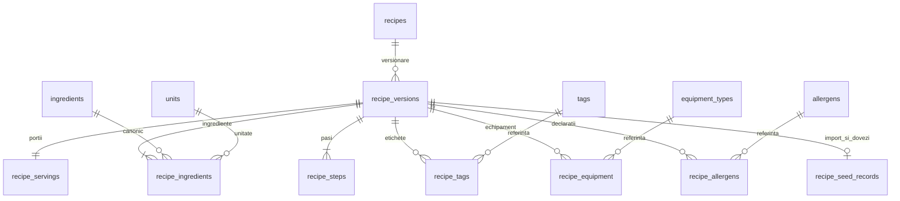

# Cookly — colecția inițială de rețete

3 noiembrie 2026. Colecția este redactată pentru proiect, cu ingrediente obișnuite
și preparate de casă relevante pentru Moldova/România. Nu este o colecție de
rețete testate practic, preluate de la un furnizor sau certificate nutrițional.

## Conținut și starea datelor

| Grup                                              | Înregistrări |
| ------------------------------------------------- | -----------: |
| Mic dejun                                         |           12 |
| Prânz                                             |           20 |
| Cină                                              |           24 |
| Desert                                            |           16 |
| Vegetarian, clasificare editorială                |           63 |
| Candidate high-protein, fără afirmație verificată |           22 |
| Total rețete distincte                            |           72 |
| Rețete verificate                                 |            0 |

Primele patru grupe sunt mese; vegetarian și high-protein se suprapun cu acestea.
Fiecare înregistrare are ingrediente canonice, cantități, unități, stare/preparare,
porții, pași, timp activ/total, dificultate, echipament, etichete, alergeni și
proveniență. Nutriția și costul au sursă, valori și statut explicit, inclusiv `null`
când nu există dovezi. Numerele de durată și cantitățile sunt propuneri demonstrative,
nu rezultate măsurate prin gătire de probă.

- `data/recipes/demonstration.v1.json`: cele 72 rețete originale demonstrative.
- `data/recipes/verified.v1.json`: colecție separată, inițial goală; nu se simulează verificări.
- `data/recipes/references.v1.json`: 24 ingrediente suplimentare, aliasuri RO/RU/EN,
  categorii, echipamente și etichete. Împreună cu seed-ul existent sunt 56 ingrediente.
- [COMPLETENESS.json](COMPLETENESS.json): raport reproductibil, cu zero erori
  structurale/semantice și 310 avertizări privind dovezile lipsă.

Caracterul economic este o intenție editorială: ingrediente comune, fără produse
scumpe obligatorii și echipament casnic. Nu există prețuri MDL/RON verificate sau
costuri numerice inventate. Este necesară o verificare de prețuri regională înaintea
unei afirmații cantitative de buget.

## Contractul JSON

Bundle: `schemaVersion: 1`, `namespace`, `locale: ro-RO`, `recipes[]`. O rețetă este
identificată prin `key` și `revision`, în namespace. Același key poate primi revizie
nouă în alt import; un bundle nu conține două versiuni ale aceleiași chei.

| Câmp                                                      | Responsabilitate                                                                                 |
| --------------------------------------------------------- | ------------------------------------------------------------------------------------------------ |
| `dataClass`                                               | `demonstration` sau `verified`, separat de starea draft/published                                |
| `regions`, `mealTypes`, `collections`                     | relevanță editorială și grupele cerute                                                           |
| `ingredients[]`                                           | slug canonic exact, cantitate zecimală pozitivă, unitate permisă, optional, state și preparation |
| `servings`, `activeMinutes`, `totalMinutes`, `difficulty` | porții și estimări de preparare; totalul include timpul activ                                    |
| `steps[]`                                                 | instrucțiuni în ordine și timer opțional                                                         |
| `equipment[]`, `tags[]`                                   | coduri/sluguri rezolvate din referințe, fără potrivire fuzzy                                     |
| `allergens`                                               | contains/mayContain, statut, sursă nullable și note                                              |
| `nutrition`                                               | bază per porție, șase valori nullable ca grup, sursă și statut                                   |
| `proteinClaim`                                            | none/candidate/verified, distinct de simpla prezență a puiului sau ouălor                        |
| `budget`                                                  | monedă, cost/sursă nullable și statut separat                                                    |
| `verification`                                            | persoană/revizie editorială, dată și URL de dovezi; toate null la demonstrative                  |
| `provenance`                                              | original/external, nume, URL și condiții de reutilizare când sunt externe                        |

Schemele Zod sunt stricte: resping câmpurile necunoscute, numerele în locul
cantităților text, valori negative, NaN, exponenți, mai mult de șase zecimale,
bucăți fracționare, referințe necunoscute și duplicate. Cel puțin un ingredient
trebuie să fie obligatoriu. Unitatea se verifică față de ingredient, nu doar față
de un enum. Limite: 1000 rețete/bundle, 60 ingrediente, 30 pași, 20 echipamente,
30 etichete, 1–20 porții și fișier maximum 8 MiB.

Validarea textului respinge conținutul gol fără să elimine spațiile din payload:
exportul și reimportul păstrează identitatea aceleiași revizii. URL-urile surselor
folosesc HTTPS și un hostname DNS/IPv4, fără credențiale sau adrese IPv6 literale;
portul opțional trebuie să fie numeric, între 0 și 65535. URL-urile invalide produc
erori în raport, fără excepții care să întrerupă validarea. Zod verifică parsarea
completă a URL-ului; SQL controlează hostul și portul, fără acces de rețea.

Slugurile canonice se rezolvă exact; aliasurile nu participă la import. Fasolea
albă fiartă/scursă și năutul fiert/scurs sunt identități explicite separate de
ingredientele uscate. Nu se introduc densități, factori crud→fiert, greutăți medii
pe bucată sau substituții. Apa de fierbere care se aruncă este menționată în
preparare/pași; nu se presupune că toată apa ajunge în porția finală.

## Nutriție, alergeni și verificare

Toate valorile nutritive din colecția livrată sunt necunoscute: `perServing: null`,
`source: null`, `status: unavailable`. Nu se transformă lipsa în zero și nu se
folosește automat nutriția ingredientului generic pentru un preparat specific.
`nutrition_data` existent rămâne pentru ingrediente per 100 g; datele unei rețete
per porție nu sunt introduse în acel tabel.

O înregistrare `verified` cere revizie editorială cu persoană, dată și dovezi,
nutriție verificată și alergeni verificați. O sursă verificată are nume, URL HTTPS,
identificator de înregistrare, licență și data observației. Validatorul verifică
structura și coerența, nu adevărul material al unei pagini sau identitatea unui
recenzor. Marcajul rămâne o atestare umană, nu o certificare automată.

Pentru high-protein verificat, controlul tehnic cere cel puțin 20% din energia
declarată din proteine, folosind 4 kcal/g; contribuția proteinelor nu poate depăși
energia totală declarată. Sursele pentru aceste două reguli sunt [anexa Regulamentului
1924/2006](https://eur-lex.europa.eu/legal-content/EN/TXT/?uri=CELEX%3A32006R1924)
și [anexa XIV a Regulamentului 1169/2011](https://eur-lex.europa.eu/legal-content/EN/TXT/?uri=CELEX%3A32011R1169).
Cele 22 de candidate nu primesc automat eticheta `high-protein`; au eticheta
`high-protein-candidate` și avertizarea corespunzătoare.

Listele de alergeni sunt editoriale și necertificate. Există indicii minime explicite
pentru ou, lapte de vacă/produse lactate, grâu/ovăz/orz și nucă; nu sunt o listă
exhaustivă și nu certifică etichetele sau contaminarea încrucișată. Lipsa unui
indiciu este avertizare pentru date neverificate și eroare când se pretinde o
verificare a alergenilor. O listă goală nu înseamnă „fără alergeni”.

Pașii pentru pui folosesc minimum 74°C, iar preparatele amestecate cu ou minimum
71°C, verificate în pasul efectiv de gătire; ouăle fierte sunt descrise ca tari.
Aceste valori sunt consultate din [FoodSafety.gov](https://www.foodsafety.gov/food-safety-charts/safe-minimum-internal-temperatures),
fără a pretinde că sursa a testat rețetele Cookly. [Documentația USDA FoodData Central](https://fdc.nal.usda.gov/data-documentation/)
este o referință pentru viitoare date de compoziție; nu a fost importată nicio
înregistrare nutritivă reală pentru aceste rețete.

## Comenzi offline

Comenzile rulează cu Node 24 și Zod existent. Nu citesc URL de DB, chei de mentenanță
sau secrete și nu contactează servicii externe. „Import” în CLI înseamnă validare
și generarea unui fișier SQL, nu aplicare pe o bază de date.

```sh
npm run recipes:validate -- --input data/recipes/demonstration.v1.json
npm run recipes:validate -- --input data/recipes/verified.v1.json
npm run recipes:export -- --input data/recipes/demonstration.v1.json --output /tmp/cookly-recipes-export.json
npm run recipes:import -- --input /tmp/cookly-recipes-export.json --output /tmp/cookly-recipes-import.sql --report /tmp/cookly-recipes-report.json
npm run recipes:check
```

Fișierele de output/report trebuie să fie noi: nu sunt suprascrise implicit.
`--check` compară artefactul existent în loc să scrie. `--migration` omite BEGIN/
COMMIT deoarece runnerul migrațiilor deține tranzacția; fără el, SQL-ul generat
include tranzacție. `--strict` produce exit 1 la orice avertizare, util pentru un
pipeline editorial; colecția demonstrativă nu trece intenționat acest mod.

CLI-ul afișează progres pe stderr și raport JSON pe stdout. Exit 0 înseamnă date
acceptate pentru nivelul declarat, nu „gata de publicare”; exit 1 înseamnă eroare
sau avertizări în modul strict. Colecția goală are status explicit și avertizare
EMPTY_COLLECTION. JSON invalid și erorile filesystem sunt raportate cu exit 1.
Nu se generează SQL când validarea sau pragul strict eșuează.

`recipes:check` verifică dimensiunea colecției 60–100, toate grupele, separarea
fișierelor și absența cheilor duplicate între ele. Compară și SQL-ul generat cu
migrațiile 14/15 și raportul cu datele actuale. Nu modifică fișiere sau DB.

Formatul ales este JSON, pentru listele imbricate de ingrediente, pași și dovezi;
nu există parser CSV în această etapă.

## Schema și migrațiile



- 13: adaugă `recipe_versions.data_class`, echipamente/alergeni pe versiune,
  registrul de import și funcțiile private de import/export. JSON-ul integral
  din `recipe_seed_records.payload` păstrează metadatele și dovezile pentru un
  roundtrip fidel, iar conținutul operațional este normalizat în tabelele existente.
- 14: referințe noi generate din references.v1.json. Nu suprascrie identitățile
  existente; conflictele de nume/alias sunt refuzate. Nu adaugă nutriție numerică.
- 15: colecția demonstrativă generată din JSON, validată înainte de generare.

Migrațiile 01–12 și lucrul existent al frigiderului sunt păstrate. Datele noi sunt
draft, cu verificare demonstrativă, și nu apar în `api.recipes`. O constrângere
împiedică publicarea unei versiuni demonstrative. Rețetele manuale existente
primesc `unreviewed`; fluxurile lor anterioare nu sunt înlocuite.

Noile tabele au PK/FK/indexuri și FORCE RLS. Anon/authenticated/service_role nu
primesc acces direct la metadate sau DML. `cookly_api` are numai SELECT intern
pentru gardurile de imutabilitate; nu poate importa/exporta. Funcțiile de
mentenanță sunt SECURITY INVOKER, cu search_path fix și EXECUTE revocat pentru
rolurile web. Nu se introduce service role key în aplicație.

Importul ia un lock tranzacțional pe namespace. Namespace/key/revision și SHA-256
asigură replay fără duplicate; aceeași revizie cu alt payload este conflict. O
revizie mai mare adaugă o versiune draft pe identitatea importată și nu schimbă
versiunea curentă/publicată. Slugurile unei rețete manuale sau din alt namespace
nu sunt preluate. Orice eroare anulează întregul bundle.

Versiunile importate sunt artefacte imuabile, inclusiv cât sunt draft. Corectează
JSON-ul și mărește `revision`, apoi generează o migrație nouă. Nu edita o migrație
aplicată și nu folosi editorul vechi pentru a modifica în loc conținutul unui seed.
O versiune verificată poate ulterior fi publicată prin fluxul editorial autorizat;
seed-ul nu publică automat nici măcar datele verificate.

## Import și export într-o bază reală

Această sesiune nu a aplicat migrații într-un proiect real. Folosește rolul de
migrații/mentenanță din procesul Supabase existent, după backup și verificare în
staging. Aplică 13→14→15 după cele existente. Nu reseta baza și nu folosi cheia
publishable sau service role pentru a imita un rol SQL de migrații.

Pentru stackul local deja pornit și configurat, comanda manuală este:

```sh
supabase migration up --local
```

Pentru un import ulterior, inspectează SQL-ul generat și aplică-l prin procesul
de migrații aprobat. Pentru export real din registrul de seed, un administrator
SQL poate rula și salva rezultatul JSON:

```sql
SELECT app_private.export_recipe_bundle('cookly-initial-recipes');
SELECT app_private.export_recipe_bundle('cookly-initial-recipes', 'verified');
```

Exportul include cea mai recentă revizie importată pentru fiecare cheie, nu
rețetele manuale fără registru. Rezultatul poate fi validat/reformatat de CLI și
reimportat fără pierdere de metadate. Exportul filtrat verificat este gol acum.

## Verificare manuală înainte de promovare

Gătește de probă rețetele, măsoară randamentul/porțiile și verifică timpii,
temperaturile și toate ingredientele din pași. Controlează etichetele și alergenii,
sursele/licențele de nutriție, baza per porție și calculele; documentează persoana
și dovezile reviziei. Confirmă separat prețurile MDL/RON și criteriile editoriale
pentru etichetele alimentare. Nu promova întregul fișier schimbând doar dataClass.

Verifică în Supabase staging: aplicare incrementală, reimport, conflict de revizie,
export valid, lipsa accesului anonim și păstrarea versiunii publicate la un import
nou. Rezultate reale în [VERIFICATION.md](VERIFICATION.md), fișiere în [FILES.md](FILES.md).

Nu sunt construite UI de rețete, matching, AI sau administrare în această sarcină.
